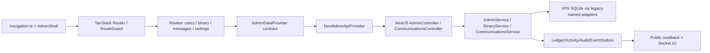

# NEXI ADMIN — IMPLEMENTATION CONTRACT MAP (A–F)

**Route-count chronology (verified 2026-11-07):** The 31-sidebar + contextual `/sandbox` count was correct for the Nov 1 source revision (`99a460a33d51a05a96ae669aee167fc866723021`) and is historical now. The deployed Admin release (`45a857de6a4d4101fc3f42738eb7d83f52bd62eb`) and current `main` (`27b78bb6f74a0ddb44e9121b15fdbb7c9f1c3c32`) each define 21 direct `NAV_GROUPS` destinations in eight groups; the route tree has 34 named page files. `/sandbox` is contextual, not a sidebar entry; `/support` is compatibility-only and `/reconciliation` hidden/unsupported. The user-referenced 24-route count is not established by the current sidebar source count. A–F decisions remain historical where not independently reverified; consult [the acceptance inventory](../../docs/quality/NEXI_113_PUBLIC_ADMIN_ACCEPTANCE_20261101.md) and current source before action.

Status: HISTORICAL 2026-10-21 proposed-work map, NOT CURRENT IMPLEMENTATION AUTHORITY. Later owner decisions and source commits supersede its future-tense recommendations. The source SHA, graph counts, CLI/MCP version, and worktree statements embedded below are historical evidence from the 2026-10-21 review unless separately dated. Current source main is `27b78bb6f74a0ddb44e9121b15fdbb7c9f1c3c32`; current Admin deployed release is `45a857de6a4d4101fc3f42738eb7d83f52bd62eb`. The canonical three-surface graph is `/srv/nexi/graphify-live/20261107/merged-graph.json` (5,953 nodes / 17,481 edges / 208 communities; SHA-256 `0c18266bab126d924e5e77acde7e940e004534a03a0bf033785fdeecf5f8337d`), queried through `@nexi-graphify-live`; see [the coverage report](../../docs/architecture/NEXI_GRAPHIFY_COVERAGE_20261107.md). The older `graphify-out/graph.json` and `@nexi-graphify` data below are not current unified-graph authority. Verify current source/deployment separately; Graphify is topology evidence only.

## Decisions and naming
NEXI is an educational DEXI reconstruction. Keep concise visible labels: Clients; Binary Trading; Ongoing Trades; Settings; Binary Trading Control; Normal / Win / Lose. Remove global Test/Production selection from ordinary navigation. Preserve internal authorization, audit, provider provenance and ledger ownership without burdening the operator with infrastructure labels. Eight compact homes; specialized operations become tabs, drawers, detail paths rather than deleted backend features. Do not introduce a second settlement engine or silently overwrite canonical market quotes.

## Source facts and unfinished work matrix
| ID | Visible owner/place | Existing source and backend authority | Verified vs absent | Smallest future change | Proof |
|---|---|---|---|---|---|
| A01 | Admin navigation and layout | Admin/src/admin/config/navigation.ts; components/shell/AdminShell.tsx; routes/__root.tsx; router.tsx | Local 8-group NAV changed; 33 nav entries + /reconciliation file route not in menu; most secondary routes still shown as direct links, not contextual tabs | Compact group entry points, contextual tabs, responsive drawer; preserve direct URLs, permission-aware routing | route inventory; typed navigation; per-role link tests; browser |
| A02 | Admin action context | Admin/src/admin/session/session.tsx, routes/sandbox.tsx, admin/data/provider.ts, nexi-api-provider.ts, NestJS admin RBAC | Global selector removed locally; session still initializes SANDBOX; many mutations pass context.environment; sandbox route can set it | Define explicit per-action context, avoid hidden state controlling all actions; maintain correct server permissions | mutation context tests and exact server authorization |
| A03 | Clients > Client Detail | routes/users.tsx, provider.getUser/listUsers, Admin API /admin/users | User directory/detail exists; no evidenced durable account Binary Normal/Win/Lose preference | Define account mode DTO/read/update; SQLite policy with version, actor/audit; display saved default | update/reload, eligibility, repeated and concurrent changes |
| A04 | Trading > Binary > Ongoing Trades | routes/binary.tsx PositionsPanel, provider.listBinaryPositions, /admin/binary/positions | Existing positions list and provider-triggered settlement; no evidenced position mode update API | Position detail control, guard open/unsettled, versioned override and effective mode readback | stale/settled rejection, direct API/DB/readback tests |
| A05 | Binary Normal/Win/Lose authority | backend/src/binary/binary.service.ts; sandbox/sandbox-scenario.service.ts; sandbox-execution.service.ts; admin/admin.service.ts | Existing directive lookup can select WIN/LOSS before normal provider path; executed sandbox commands can be account-targeted and optionally position-targeted; admin request/execute reject NODE_ENV=production; they are NOT the requested general account/position contract | Decide/reuse smallest single durable policy authority and settle path; resolve precedence (position > account > Normal), expiry and per-position concurrency without broad rewrites; retain canonical ledger atomic settlement | focused expiry, idempotency, audit and payout test receipts |
| A06 | Binary chart/result consistency | binary.service.ts settlement; Public frontend/app/dashboard/binary/page.tsx and price/candle readers, backend quote gateway | Current sandboxExpiryPrice selects settlement price; full chart evolution to match selection before expiry NOT evidenced | Trace actual chart quote/candle consumer; scope reproducible research chart stream separately from provider feed; recover after refresh | chart+result consistency, user isolation, reconnect |
| A07 | Trading > Binary > Settings | routes/binary.tsx PairsPanel; provider.updateBinaryPair; /admin/binary/config and risk/pairs | Source has five-duration per-pair config, payout and stake capability; field-level deployed parity unverified | Make five boxes/duration, payout/min/max/enable clear and editable where DTO supports; do not assume arbitrary new duration accepted | Admin mutate -> DB -> Public config readback; invalid values |
| A08 | Markets | routes/assets.tsx, market-feeds.tsx; provider.listAssets/listMarkets; /admin/market/assets, market/feeds, feed status; MarketPair/provider config | 53 asset catalog reference and provider mapping are existing design; current persistence/readback not checked | Preserve accessible 53-asset management and price-data source controls under Markets | list/search/update/readback and feed provenance |
| A09 | Wallet & Finance | routes/wallets.tsx/networks.tsx/deposits.tsx/withdrawals.tsx/ledger.tsx; Admin controller wallet-networks, currencies, addresses, deposits/withdrawals, ledger | Different backend writers/authority; /reconciliation is non-nav unavailable placeholder | Put deposit addresses, networks and wallet/account review in intelligible tabs, preserve separate backend contracts; keep Ledger and queues | context/link and readback, no direct ledger writes |
| A10 | Mining/Loans | routes/mining.tsx, loans.tsx; Admin /mining-plans POST/PATCH and /loan-plans POST/PATCH | Config APIs exist; persisted rates/limits and Public parity not verified this run | Preserve plans edit/read and inspect field-level Public consume path | create/edit/disable/refresh/Public readback |
| A11 | Communications > Messages | routes/messages.tsx; provider.listMessages, listMessageModeration, resolveMessageModeration; /communications/admin/messages; communications service/gateway | Current UI is list + moderation, **no Admin chat composer/reply workflow evidenced**. communications.controller.ts offers POST /communications/messages (authenticated user), GET /communications/conversations and GET /communications/admin/messages (Admin read), but no explicit Admin-specific thread reply route; inspect role and recipient semantics before reuse. Support ticket reply exists at /admin/tickets/:id/reply but is different | Map canonical conversation/read/send endpoints and permission; implement two-panel conversation list/thread/reply/unread using existing service where supported; moderation secondary tab | Admin send -> Public receive -> reply -> Admin read; reconnect/history |
| A12 | Communications remainder | support, notifications, announcements, learn routes + corresponding provider methods | Existing features maintained | Group logically without removing publication/approval capabilities | route/provider/action parity |
| A13 | Public settings | routes/frontend-control.tsx/navigation.tsx/localization.tsx/feature-flags.tsx | Controls exist as separate destinations | Merge navigation presentation into Public App Settings, preserve distinct API owners and validation | Admin edit -> Public readback |
| A14 | Governance and System | admins/roles/approvals/audit/health/maintenance; /reconciliation hidden | Specialized routes exist. /reconciliation is not complete system | Group in Administration & Settings; no fabricated reconciliation capability | permission and route/direct-URL verification |

## Source-to-owner graph (real boundaries)

## Dependency order: future implementation, NOT started
1. Repair A02 action-context semantics first, with server contract proofs. Navigation label changes must not accidentally send a hidden SANDBOX context for routine Admin actions.
2. Complete A01 contextual workspaces without deleting routes or hand-editing generated routeTree.gen.ts; preserve AdminDataProvider and the existing TanStack Start plugin wrapper.
3. Design and test one backend Binary policy contract (A03-A06): account default, position override, exact effective precedence, lifecycle and durable settlement. Keep normal provider path unchanged. Existing sandbox form is not adequate evidence of the final feature.
4. Complete A07 and A10 field-level Admin→backend→Public configuration parity, and A08/A09 preservation, without rewriting finance.
5. Add A11 two-way Messages interface on an evidenced communications contract; don't repurpose ticket reply blindly.
6. Verify A12-A14, focused type/lint/tests, then separate release and browser acceptance per owner instructions.

## Exact acceptance evidence (future)
- Navigation: all existing routes/direct links still work for permitted roles; smaller viewport, selected context, search/filter/refresh/back all work.
- Binary: choose account default Normal/Win/Lose and read after reload; open eligible position and override before settlement; version/race/closed-position tests; selected result, quote/candle display and History/Ledger/Activity agree after refresh. No duplicate settlement or second finance writer.
- Settings: duration/payout/min/max/enable, Mining and Loans parameters persist and show correctly in Public; values invalid under backend rule rejected.
- Messages: two-way Admin↔Public reply/history and unread/reconnect behavior, plus moderation independent from chat.
- Source checks: Admin tsc + focused ESLint previously passed only for the initial four-file change, not these new features; Graphify/Fallow are static; actual Nest backend tests and browser acceptance remain undone.
- Release: source SHA, build artifact, deployment identity and release-matched Sentry are different proof classes; no deployment is authorized by this map.

## Conflict / known gaps
- Route-count chronology: the Oct 21 snapshot had 33 visible links plus the then-counted non-navigation /reconciliation route; the Nov 1 source had 31 direct sidebar entries plus contextual Sandbox; Nov 7 source main has 21 direct NAV_GROUPS destinations and 34 named route files. Preserve each as dated source history; use the dated route correction above for current counts.
- Some prior documents say new eight-workspace IA is only proposed. Current VM has uncommitted eight-group code; contextual tabs remain proposed.
- The existing docs use prolonged 'simulation' names, despite owner preferring 'Binary Trading Control' in visible UI. Use simple UI labels, clear internal contracts.
- Requirement of near-expiry coherent chart changes is owner-stated historical reference, NOT an existing NEXI verified chart API.
- Owner has not authorized handing over this package yet; WORK_SSH_NEXT_EXECUTION_HANDOFF_2026-10-21.md remains draft, not controlling.
- No current deployed Admin identity or authenticated runtime acceptance was checked in this mapping pass.

## Historical per-workspace inventory — 2026-10-21
The following 33 links were registered under eight headers in the dated snapshot; this is not the current navigation inventory. Keep existing URL and permission even when making secondary items contextual:
- Overview: /overview; /health cross-link.
- Clients: /users primary; /kyc and /sessions inside client area.
- Trading: /binary and /spot primary; /settlements, /exposure and /sandbox contextual; keep /sandbox URL as compatibility only until its commands are replaced by verified account/position controls.
- Wallet & Finance: /wallets primary; /networks, /deposits, /withdrawals, /ledger contextual.
- Markets: /assets primary; /market-feeds contextual.
- Products: /mining and /loans.
- Communications: /messages primary; /support, /notifications, /announcements, /learn contextual.
- Administration & Settings: /frontend-control primary; /navigation, /localization, /feature-flags, /admins, /roles, /approvals, /audit, /health, /maintenance contextual.
- /reconciliation: preserve file/deep link, hide as existing unavailable placeholder. No reconciliation API to invent.

## Current-source follow-up — 2026-10-26 (A03/A04)

Direct inspection of the current working source confirms that the account Binary research default (A03) and eligible open-position override (A04) are implemented across Admin and Backend. This supersedes the “no evidenced” statements in the historical A03/A04 rows above; it does not reassess A05/A06 or establish deployed/runtime/browser behavior.

- **A03 account default:** `Admin/src/routes/users.tsx` submits the selected account mode through `provider.setBinaryResearchDefault`, displays current/proposed state, requires a reason under `binary.edit`, then refreshes the users list. `Admin/src/admin/data/nexi-api-provider.ts::setBinaryResearchDefault` PATCHes `/admin/users/:id/binary-research-default`. `backend/src/admin/admin.controller.ts::setBinaryResearchDefault` requires `binary.edit` and validates `BinaryResearchDefaultDto` (`backend/src/admin/admin.dto.ts`); `backend/src/admin/admin.service.ts::persistBinaryResearchControl` restricts this to approved research accounts and persists `User.binaryResearchDefault` with an idempotent governance command and audit record in a Prisma transaction.
- **A04 position override:** `Admin/src/routes/binary.tsx::PositionResearchControl` exposes editing only for open, research-eligible positions. The detail shows account default, override, effective mode, and control version; the confirmation requires a reason and `binary.edit`, submits the row's `researchControlVersion`, supports `DEFAULT` to clear the override, and refreshes authoritative position data after success. `Admin/src/admin/data/nexi-api-provider.ts::setBinaryResearchPositionOverride` PATCHes `/admin/binary/positions/:id/research-control`. `backend/src/admin/admin.controller.ts::setBinaryResearchPositionOverride` requires `binary.edit`; `BinaryResearchPositionDto` validates mode, expected version, reason, and idempotency key. In `backend/src/admin/admin.service.ts::persistBinaryResearchControl`, the position must belong to an approved research account and remain active/unexpired; the update is conditional on the expected version, increments that version, and writes the audit record in the same transaction. A stale, expired, or closed position returns a conflict for refresh/retry.

These are source-confirmed contracts only. No claim is made here about current service availability, deployed artifact identity, or browser verification.

## Graph and tool evidence / exact boundaries
- Local Graphify CLI `god-nodes --top 12`: financial gateway (299 links), `AdminDataProvider` (143), `NexiAdminApiProvider` (142), `AdminService` (105), `AdminController` (101). They are hubs, **not** single responsibility owners for all actions.
- Local `mcpc @nexi-graphify` v0.7.0 → Graphify MCP 0.9.92: `graph_stats`, `get_neighbors`, `god_nodes` return valid results with default timeout; 10 MCP tools discovered. A BinaryService label was ambiguous: use `backend/src/binary/binary.service.ts::BinaryService` or exact graph node ID; do not choose test symbols.
- Fallow `guard` inspected `navigation.ts` and `AdminShell.tsx` and found no boundary violations; this is not proof of live navigation behavior.
- Canonical source-only `backend/src/sandbox/sandbox-scenario.service.ts`: mode finder supports executed command scoped by account and optionally position, with expiration; `backend/src/admin/admin.service.ts` and `backend/src/sandbox/sandbox-execution.service.ts` reject controls in `NODE_ENV=production`. No UI rename changes that constraint.
- `Admin/src/admin/session/session.tsx` still defaults environment to SANDBOX. `AdminShell.tsx` still shows `EnvironmentBadge`; previous change removed selector only. Do not declare environment architecture corrected.
- Communications: `Admin/src/routes/messages.tsx` renders moderation and read-only message tables, while `backend/src/communications/communications.controller.ts` owns authenticated message send/read/list and Admin message read/moderation. Admin-to-client two-way composer/permissions remain to be verified.
- Retired Cloudflare app runtime must not be resurrected merely from `D1*` legacy names.

## Closeout status and next source proofs
A01-A14 are documented with concrete file ownership and expected proof, but **A01-A14 are not all implemented or runtime verified**. Next targeted proof required: exact Binary account/position policy DTO/storage/version and price chart consumer; per-resource Admin/Public setting parity; Admin two-way message command+permission. After these contracts are settled, full UI integration, focused tests, deployment and browser checks can occur without replaying previously owner-accepted financial campaigns. The separate WORK_SSH handoff file remains a draft; it is not activated.

## Current revision note — 2026-11-07

This file is a dated historical design/contract map. Its future-tense recommendations and route counts describe the 2026-10-21 snapshot; they are not current source status. Current source main is `27b78bb6f74a0ddb44e9121b15fdbb7c9f1c3c32`; the current Admin route inventory has eight workspaces, 21 direct navigation destinations and 34 named route files. Sandbox is a route-only/contextual destination, not a direct NAV_GROUPS entry. Current owner decisions consolidate Public Navigation and Feature Controls under Public App Settings and keep customer Sessions under Clients.

Historical finding from the 2026-10-21 source review: the then-reviewed `ReferralVipService` did not establish cumulative credited-external-deposit qualification, first-deposit reward decisions or customer-level panels. **Superseded for current source** by the VIP/referral closure committed in `6d734e8` and the current [NEXI Admin Operator Usage Guide](NEXI_ADMIN_OPERATOR_USAGE_GUIDE.md). Production readiness remains separate: current SQLite schema and migration history must be checked against migrations 0016–0020, and deployment/runtime acceptance must be verified independently.
