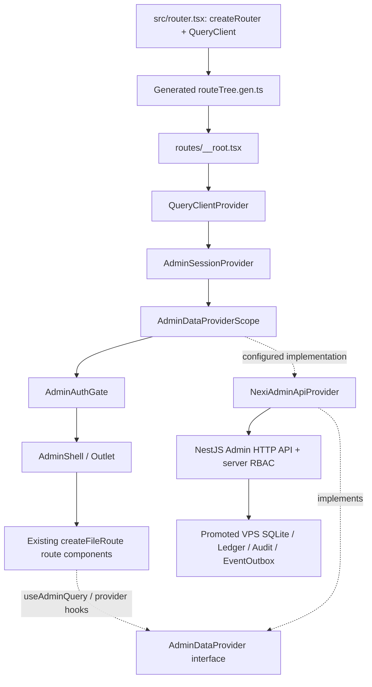
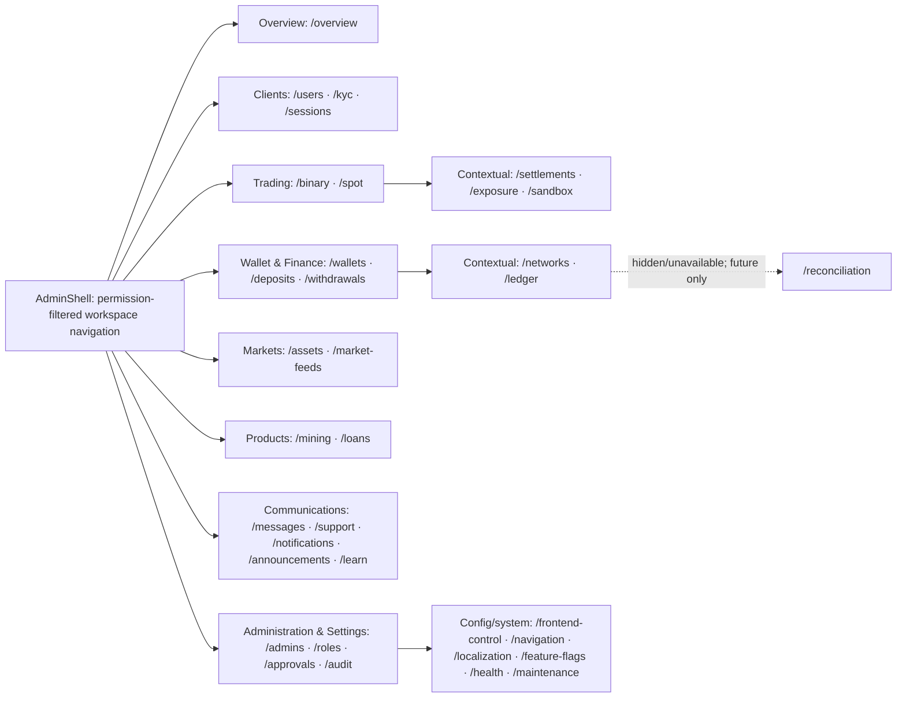

# NEXI Admin — Verified Diagrams and Execution Boundary
Status: DESIGN / DOCS ONLY — 2026-10-21. Source checkpoint: `Mellonelay/Nexi@6da08471ef200b6cadf96ef3d49ed85fc0f12fc4`, corroborated by current Worker-0 HEAD/origin and Graphify indexed commit. Not implementation, deployment or browser verification.

Read with `TANSTACK_ARCHITECTURE_AND_ROUTE_MAP.md`, `OPERATOR_WORKSPACE_IMPLEMENTATION_MAP.md`, `Admin/AGENTS.md` and current owner decisions. The three owner-provided PNG diagrams express intent; their linear boxes should **not** be interpreted as literal runtime call order, nor as proof of an existing API.

## A. Existing TanStack Start application composition



**Do not** hand-edit the generated route tree, add a second Start/Router Vite plugin behind the existing `@lovable.dev/vite-tanstack-config`, duplicate cache ownership, or move financial authority into TanStack Start. `sessionStorage` access-token behavior means authenticated UI fetches cannot simply move into SSR loaders.

## B. Operator navigation: eight homes, existing route files remain



Count: **33 sidebar destinations** in `navigation.ts`, plus one non-sidebar `/reconciliation` named route = **34** named functional file-route destinations, excluding `index.tsx` and `__root.tsx`. “Hide from navigation” does not mean delete or block an existing deep link. All useful backend capabilities and RBAC remain intact.

## C. Proposed controlled Binary research lifecycle (not yet proven as an API)

```mermaid
sequenceDiagram
  participant A as TanStack Admin
  participant N as NestJS
  participant D as VPS SQLite / Ledger
  participant R as EventOutbox / Realtime
  participant P as Next.js Public
  A->>N: Change eligible test account default
  N->>D: Validate and persist policy + audit
  N-->>A: Policy version / readback
  P->>N: Open eligible research Binary position
  N->>D: Create position with resolved account default
  N-->>P: Position and expiry data
  opt Explicit pre-settlement test-position override
    A->>N: Set override + expected position version
    N->>D: Check eligible, open, not settling; atomically update/audit
    N-->>A: Effective policy / updated version or conflict
  end
  alt NORMAL
    N->>N: Provider-derived settlement per product rules
  else SIMULATED_WIN or SIMULATED_LOSS (eligible test only)
    N->>R: Publish isolated, labeled simulated quote/candle projection
    R-->>P: Research chart projection
    N->>N: Compute internally consistent simulated test settlement
  end
  N->>D: Canonical settlement, idempotency, ledger/activity, audit/outbox
  D-->>N: Committed state
  N->>R: Publish result after durable commit
  R-->>P: Result/activity invalidation
  R-->>A: Position state invalidation
  P->>N: REST readback/recovery on refresh/reconnect
  A->>N: REST readback/recovery
```

The account-level proposed mode set is NORMAL / SIMULATED_WIN / SIMULATED_LOSS; a position-level choice may additionally be INHERIT. These names are design terms, not confirmed backend enum values. The existing `/sandbox` form is **not proof** of a durable per-account or pre-expiry per-position override. Backend DTO, permissions, transaction/state version rule and simulation chart provenance require direct verification before implementation. A test projection cannot overwrite canonical feeds or unrelated users' Spot/Margin charts.

## Execution checklist for later Work session

1. Recover dirty source and existing protected docs; verify `main`, `origin/main`, local changes and deployed generations independently.
2. Inventory `routeTree.gen.ts`, `navigation.ts`, `AdminShell.tsx` and all 34 named route destinations. Preserve `/reconciliation` as hidden/unavailable unless the canonical dataset exists.
3. Keep single route/component/API-owner matrix. Implement operator groups and contextual tabs first; do **not** mass-move files or duplicate routes.
4. Trace `users.tsx`, `binary.tsx`, `sandbox.tsx`, `settlements.tsx` through `AdminDataProvider` and `NexiAdminApiProvider` to actual NestJS controller/DTO/storage. Only implement absent simulation seams after checking backend authority and isolation.
5. Preserve markets (53 assets/feeds), Binary duration/payout/limits, Mining/Loans, Wallet/Finance/Ledger, messages, content, Public controls and audit, with their existing backend owners.
6. Verify typecheck, routing/permission/link behavior, focused provider/NestJS tests, then separate Admin/Public browser and durable readback; do not infer runtime acceptance from Graphify or a build.
7. Maintain one semantic writer. No deployment, service restart, DB/ledger mutation, or real trade-operation change is authorized by this documentation task.

## Documentation evidence

- TanStack Router file routes: https://tanstack.com/router/latest/docs/framework/react/routing/file-based-routing
- TanStack Start overview: https://tanstack.com/start/latest/docs/framework/react/overview
- TanStack Router search: https://tanstack.com/router/latest/docs/framework/react/guide/search-params
- Source: `Admin/src/router.tsx`, `src/routes/__root.tsx`, `src/admin/config/navigation.ts`, `src/admin/data/context.tsx`, `src/admin/data/provider.ts`, `src/admin/data/nexi-api-provider.ts` and route components at source checkpoint above.
