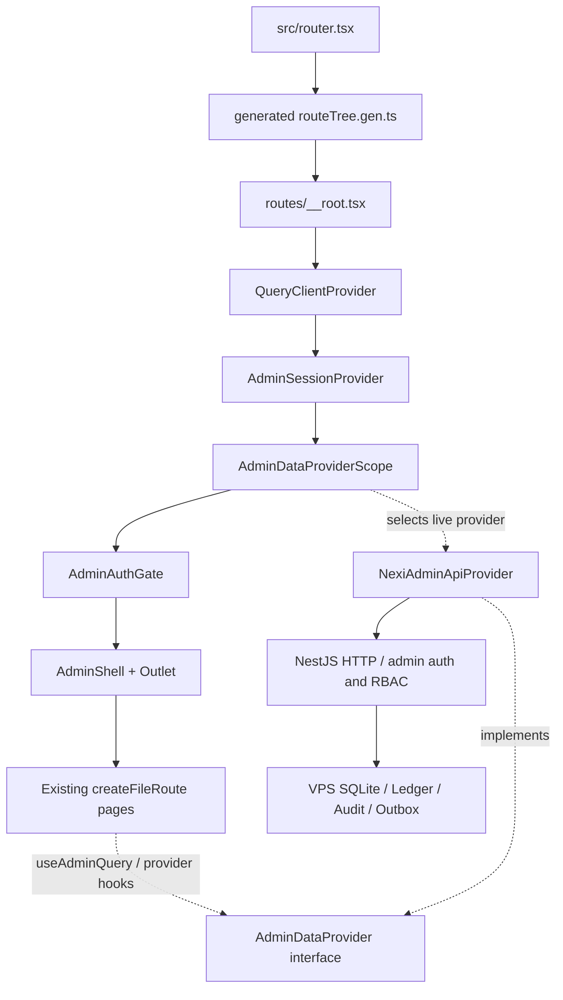
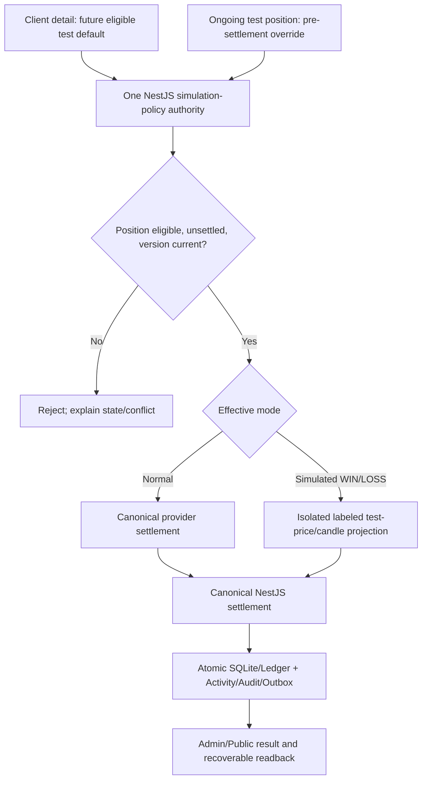

# NEXI Admin — compact workspaces and implementation map

Status: OWNER-APPROVED DESIGN REFERENCE; Stage B shell repair deployed as Admin release `737355124993705935f9aa56f743a9f1f61a2bf4` on 2026-10-31. At 979×715, authenticated browser evidence confirms the role-visible eight-workspace selector, route-based active selection, contextual Frontend Control tabs, page-specific search, and removal of the inert global search/hamburger. The 440×956 target was unauthenticated, so authenticated mobile parity and complete workspace/page visual acceptance remain open. The approved reference remains intent authority; it does not establish that every route, action or viewport matches. Backend/Public remain on release `a72c3127ffc448215cc7a724c4f5f6ca6e593b1b`. Admin `/support` direct reload and retired-ticket rendering were verified; the existing synthetic Messages thread remains untouched pending owner disposition. See [the Stage B acceptance receipt](../../tasks/evidence/nexi-final-product-acceptance-20261031.md). Read with `TANSTACK_ARCHITECTURE_AND_ROUTE_MAP.md`, `Admin/AGENTS.md`, root `AGENTS.md`, and current proof register.

## Decision and route disposition

Eight primary operator workspaces replace the flat navigation presentation; they do **not** authorize removing any filesystem route, NestJS endpoint, data provider method, role permission, deep link, or working capability. Distinguish **hide from primary menu**, **contextual link/tab**, **retain operational destination**, and **later retire after dependency proof**. Existing route `/reconciliation` has a named route but no nav item and no canonical reconciliation dataset; leave hidden/unavailable, do not claim completed, and do not invent a writer.

| Operator home | Primary landing | Contextual existing routes | UX action |
| --- | --- | --- | --- |
| Overview | `/overview` | `/health` | Operational KPIs and cross-links; diagnostics under System |
| Clients | `/users` | `/kyc`, `/sessions` | Account detail hosts verification, sessions, balance/activity links, and eligible research preferences |
| Trading | `/binary` with Spot accessible | `/spot`, `/settlements`, `/exposure`, `/sandbox` | Binary ongoing/history/settings, risk and conditional test controls; preserve existing paths |
| Wallet & Finance | `/wallets` | `/networks`, `/deposits`, `/withdrawals`, `/ledger`; hidden `/reconciliation` | Deposit destinations vs client balances remain distinct canonical domains; review queues and Ledger readable |
| Markets | `/assets` | `/market-feeds` | Preserve all 53 assets, source mapping, provenance and feed truth |
| Products | `/mining` | `/loans` | Configurable plans and product lifecycle; no invented referrals route |
| Communications | `/messages` | `/support`, `/notifications`, `/announcements`, `/learn` | Messages is the operator conversation workspace; Public chat uses the canonical user-scoped support conversation. Support retains help/contact information, while legacy ticket create/reply/lifecycle actions are retired. Notifications and publishing remain distinct. |
| Administration & Settings | `/frontend-control` | `/navigation`, `/localization`, `/feature-flags`, `/admins`, `/roles`, `/approvals`, `/audit`, `/health`, `/maintenance` | Public settings + staff governance + system; permission-sensitive secondary tabs |

All 33 NAV_GROUPS destinations remain represented in local navigation data, subject to permission. The deployed Admin shell uses an eight-workspace selector whose entries are filtered through existing role permissions and whose selected workspace follows the active route. At 979×715, the authenticated selector reached all eight configured landing routes; the Binary route showed five Trading tabs, and Frontend Control showed five contextual tabs. This is not proof that contextual tabs or merged screens are complete across all routes, nor authenticated mobile parity. The additional named `/reconciliation` route stays hidden and unavailable. Review any future route removals with import/deep-link/consumer evidence before changing the generated route tree.

## Actual ownership and diagram interpretation

The attached October 21 diagrams are intent/architecture maps, not exact React JSX nesting or existing endpoint proof. In particular, `AdminDataProvider` and `NexiAdminApiProvider` are service/data dependencies consumed by route components, **not** children rendered sequentially beneath those route components. The root mounts QueryClientProvider, AdminSessionProvider, AdminDataProviderScope, AdminAuthGate, AdminShell and an Outlet. `AdminDataProvider` is an interface and `NexiAdminApiProvider` the live implementation, with explicit local mock variant.

TanStack Start already exists, using the current Vite wrapper. Do not add duplicate TanStack Start/Router Vite plugins, hand-edit generated `routeTree.gen.ts`, replace routes with a new application, move business/financial authority to a Start server function, or assume the QueryClientProvider means every existing query uses TanStack Query. New loader/query migration requires an explicit single cache owner and verified SSR/session boundaries. Preserve URL/deep links; nonsecret table search/page/status belong in validated search parameters where implemented.

## Binary research flow — design contract, not implemented claim

Two context entry points: `Clients > Client Detail > Binary Research Policy` (default for **future eligible simulation positions**) and `Trading > Binary > Ongoing > Position Detail` (per-position test override **before settlement**). Proposed Normal / Simulated WIN / Simulated LOSS modes must be isolated to authorized research/test positions; the current `/sandbox` scenario form is not proof of a per-position API. Actual backend DTO, lifecycle, version guard, policy precedence and readback are **UNKNOWN pending source verification**. No production outcome or market feed changes are authorized by this document.

The test visual projection and simulated result must be causally consistent with selected direction, entry, expiry, payout and displayed candles across reconnect/refresh. Canonical quotes used by unrelated Public markets, Spot/Margin and genuine price-derived settlement must not be rewritten. The simulation must be explicitly distinguishable in all applicable test readbacks.

## Communication and product parity

HISTORICAL DESIGN NOTE (2026-10-21): Messages was proposed to evolve into a selectable conversation list and thread/reply composer. Later October 24/25 Support/Messages release and browser receipts establish the implemented two-way flow within their scope; inspect current source before treating any proposed element as missing. First verify existing `/messages` provider methods, NestJS controllers and realtime events; do not claim attachments, sending, subscriptions or new endpoints before contract proof. Keep support tickets separate.

Product configuration remains Admin-controlled **where existing backend authority supports it**: Binary five duration boxes/payout/min/max and pair eligibility, Mining plans/payout parameters, Loans settings, Markets 53 assets and feeds, Wallet deposit networks/addresses, Public navigation and supported content. Exact current persisted values and whether the five Binary duration seconds are freely editable require readback, not historical defaults. Never equate a visible form with a durable mutation.

## Execution order and acceptance for next Work session

1. Recover live Worker-0 `main`/dirty tree, `Admin/AGENTS.md`, existing docs/screenshots and current proof; preserve concurrent edits.
2. From `navigation.ts`, `routeTree.gen.ts`, route files, `AdminShell` and provider contracts, create a source-accurate action/path/permission/producer matrix. Graphify is bounded topology support; inspect real source for every change.
3. Implement shell navigation re-grouping and contextual links without removing deep links or hiding necessary role access. Preserve one semantic writer.
4. Implement approved UI elements by reusing current route components and existing provider methods; for missing Binary account/position contracts, first prove backend route/DTO and storage owner or leave UI explicitly unavailable.
5. Run focused type/lint tests, route/link/permission checks and provider/HTTP/SQLite tests where affected. Treat generated route tree as generated output only.
6. Render desktop/narrow Admin UI in the owner-authorized browser: direct URLs, refresh, back/forward, filters, modal action/error states and account/position context.
7. Verify Admin -> NestJS -> persisted readback -> Public across configurations, messaging and eligible simulation paths where implemented. Distinguish SOURCE_IMPLEMENTED, TESTED, INTEGRATED, DEPLOYED, BROWSER_VERIFIED, OWNER_ACCEPTED.

**Stop condition for this documentation slice:** source-mapped route disposition and diagrams exist, preserve existing capabilities and identify all unproven contracts. No Admin build, deployment, DB operation, protected data edit, service restart or Git fan-in in this docs-only slice.
