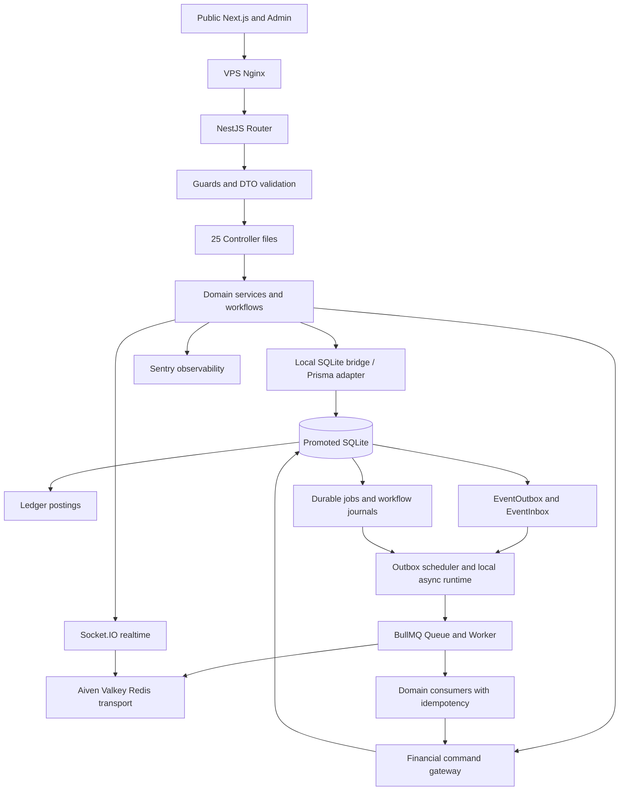

# NEXI SQLite backend routing map

The full source-derived 223-path API and controller mapping is [here](../../docs/architecture/NEXI_BACKEND_API_SQLITE_SOURCE_MAP.md).

## Architecture diagram

See `backend/src/app.module.ts`, `backend/prisma/schema.d1.prisma` and checked `docs/contracts/openapi.json` for exact authority.
