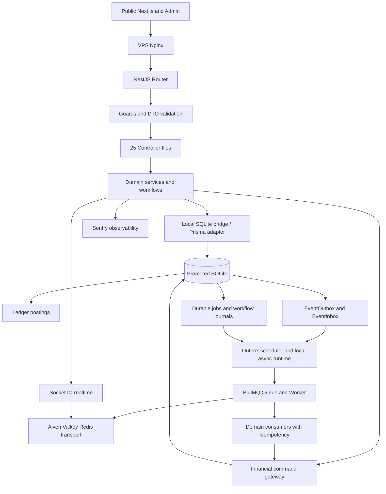

> **2026-11-18 supersession:** This dated design/source/routing snapshot is preserved for chronology, NOT current implementation authority. NEXI owner confirms the **current Binary/Admin source and approved design** as correct, including guarded research controls and the implemented Binary sandbox candle/chart flow. Current code and latest owner decisions supersede historical "missing/proposed" claims, obsolete route counts and retired Kernel/test bans. See [current-source architecture authority](../../docs/architecture/NEXI_CURRENT_SOURCE_ARCHITECTURE_AUTHORITY_20261118.md) and its full 30-document crosswalk.

# NEXI SQLite backend routing map

2026-11-18 current-contract note: `docs/contracts/openapi.json` records 253 paths at the November 18 candidate, including optional query metadata for market trades/depth. The earlier 223-path map and 25-controller count below are historical. See [current architecture reconciliation](../../docs/architecture/NEXI_ARCHITECTURE_DOCUMENT_RECONCILIATION_20261118.md).

The linked 223-path API inventory is a HISTORICAL 2026-10-20 snapshot, superseded by later Support/Messages route changes. It is not an active generated endpoint contract. For current API consumers inspect the installed NestJS controller/DTO/guards and regenerate `docs/contracts/openapi.json` only for a scoped source revision; do not infer ticket routes remain active from old tables. Historical source mapping: [archive-era map](../../docs/architecture/NEXI_BACKEND_API_SQLITE_SOURCE_MAP.md).

## Architecture diagram

See `backend/src/app.module.ts`, `backend/prisma/schema.d1.prisma` and checked `docs/contracts/openapi.json` for exact authority.
