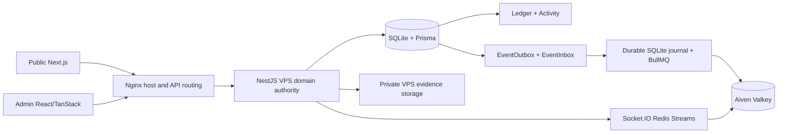

# NEXI Cross-Surface Feature and Authority Map

**Use:** navigation from user/admin behavior to canonical implementation. Source mappings use repository `main`; actual deployed behavior requires independent proof. This is a cross-reference, not a second specification of financial or market rules.

## Runtime topology

## Feature-to-owner matrix

| Capability | Public source route | Backend domain | Admin control | Durable/realtime boundary |
|---|---|---|---|---|
| SIWE/security | `/login`, `/signup`, Settings | `auth/`, `users/`, `profile/` | `users`, `sessions`, `roles` | SQLite sessions/security events; wallet signature verification |
| KYC | Settings upload/status | `kyc/` | `kyc` | private VPS evidence files, SQLite status and Admin audit |
| 53-asset catalog | Dashboard, Asset Detail | `market/` | `assets`, `market-feeds` | provider-backed market data and quote freshness |
| Wallet accounts | Wallet Overview/Funding/Spot/Margin/Options/Finance | `wallet/`, `financial/`, local SQLite gateway | `wallets`, `ledger`, `reconciliation` | SQLite Ledger/Activity; five account scopes |
| Deposits/withdrawals | Wallet | `wallet/`, `financial/` | `deposits`, `withdrawals`, `networks` | SQLite + private proofs + audit/event publication |
| Same-user and user-to-user transfer | Wallet transfer modal | `financial/`, local SQLite gateway | `wallets`, `audit` | balanced ledger postings, Activity and idempotency |
| Convert | Wallet | `conversion/` | governed currency/config controls | backend quote+expiry, zero separate commission, Ledger |
| Spot | Spot trading surface | `spot/`, local SQLite gateway | `spot`, `settlements` | Spot account, orders/fills, ledger and events |
| Margin | Spot/Margin trading surface | `spot/margin.*` | `exposure`, `spot` | USDT transferable account; real base-asset liabilities/repayments |
| Binary Options | `/dashboard/binary` | `binary/`, `settlement/`, `sandbox/` | `binary`, `settlements` | BINARY USDT reserve and WIN/LOSS settlement; isolated simulation |
| Mining/Earn | `/dashboard/mining` | `mining/`, `workflows/` | `mining` | Finance commitments, accruals and Activity |
| Loans | `/dashboard/loans` | `loans/`, `workflows/` | `loans`, `approvals` | Finance disbursement, obligations, repayment |
| VIP/referral | Settings/Profile | `referral-vip/` | `users`, `audit` | account attribution and reward history, Ledger rewards |
| Communications | Messages, Support, Learn, Announcements | `communications/`, `notification/` | `messages`, `support`, `learn`, `announcements`, `notifications` | SQLite persistence, event delivery/read state |
| Frontend governance | Public routes/components | `admin/`, configuration services | `frontend-control`, `feature-flags`, `maintenance`, `navigation` | explicit audited configuration; Public readback |
| Monitoring | Browser instrumentation | `instrument.ts`, `observability/` | `src/sentry.ts` | Sentry telemetry only; SQLite/Ledger remain financial truth |

## Acceptance/evidence separation

Feature map presence proves navigation only. For every feature, record separately when asked: `SOURCE_IMPLEMENTED`, `TESTED`, `DEPLOYED`, `RUNTIME_VERIFIED`, `BROWSER_VERIFIED`, `OWNER_ACCEPTED`. Use actual source SHA and deployed artifact IDs. For the current paired-Codex workflow, browser ownership is Chrome DevTools/CDP at `127.0.0.1:5858`; Polypane/5859 is retired. Authenticated Coinbase/other EIP-1193 owner signatures remain separately authorized. Do not infer browser verification from a source map.

The 92-table/11,802,372-row export and the 2026-10-17 empty-SQLite/D1 sample are HISTORICAL migration-phase evidence, not current runtime state. Promoted VPS SQLite is the active canonical application/financial database under the October 25 owner and source authority. Four later financial gates were closed by owner acceptance with untested outcomes; do not reopen them from the old snapshot. Independent off-site backup/restore and present runtime claims still require distinct proof. No historical D1 equality assumption applies to the current production source.

## Ownership routing

Backend domain and contracts: [Backend](../backend/README.md). VPS components/data flow: [Runtime map](NEXI_VPS_BACKEND_RUNTIME.md). User behavior/design: [Frontend](../frontend/README.md). Admin permission/control: [Admin](../admin/README.md). Release/telemetry: [Sentry](../operations/NEXI_SENTRY_OBSERVABILITY.md). Older dated phase and production-program records are historical only.
