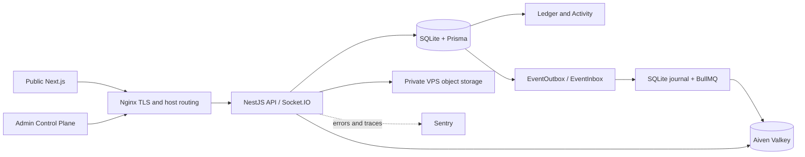
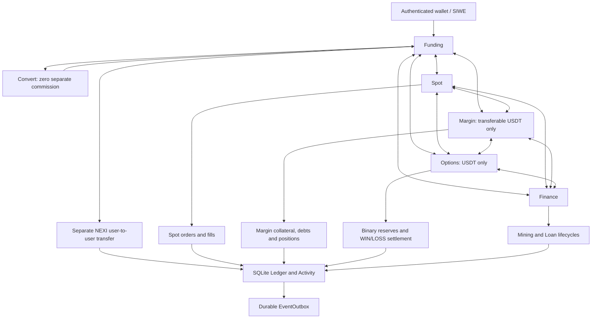
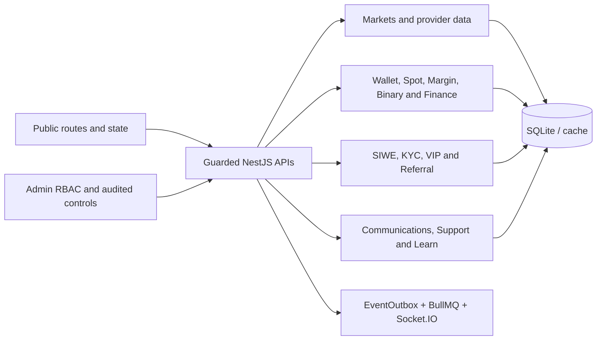
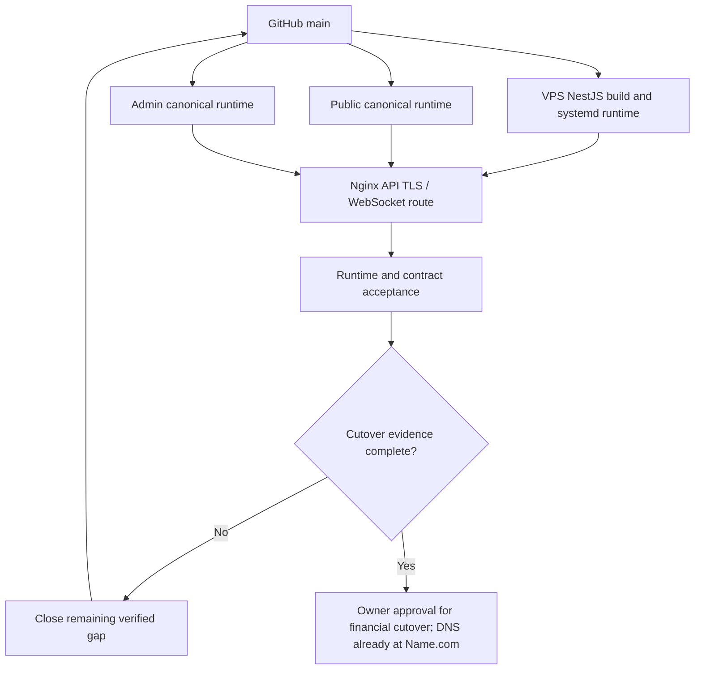
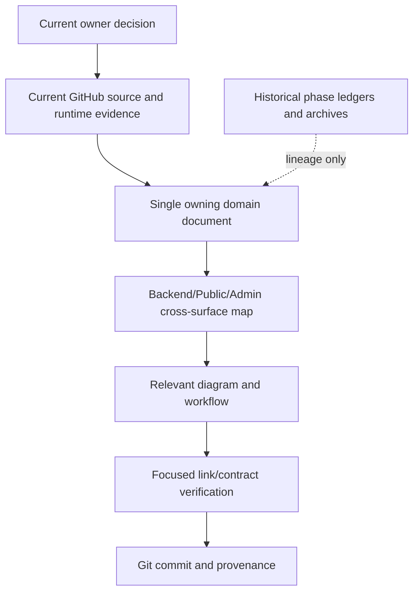

# NEXI Architecture and Workflow Diagrams

These Mermaid diagrams are versioned source documentation and render in GitHub Markdown. They describe current responsibility boundaries and approved flows, **not proof that every edge has passed runtime acceptance**. Verify actual source paths and deployed release identity before consequential changes.

## 1. Runtime and data ownership

NestJS owns domain decisions. Name.com DNS routes public hostnames to the VPS Nginx/NestJS path; SQLite is the intended VPS durable store, Ledger accounting truth, EventOutbox/EventInbox durable delivery boundaries, and Aiven Valkey transport/realtime only. Cloudflare D1 remains populated and financially authoritative pending controlled delta and owner-approved writer cutover; Worker cron/queues/workflows remain active. Cloudflare Observability remains disabled. The current VPS SQLite core financial tables are empty; do not infer synchronized production behavior.

## 2. Financial accounts and transaction topology

**Constraint:** arrows between account pairs denote eligible transfer directions only, subject to account ownership, asset support, available funds, and reserve/loan restrictions. They do **not** imply that committed collateral or liabilities are freely movable, or that transfer automatically converts assets. User-facing Margin/Options transferable assets are USDT; legitimate non-USDT Margin liabilities remain accounted for internally. Overview aggregates genuine balances in estimated USDT equivalent without minting USDT or double counting.

## 3. Backend / Public / Admin feature responsibility

Private KYC/deposit evidence is stored on the VPS; metadata and domain state remain in SQLite.

Use [cross-surface feature matrix](CROSS_SURFACE_FEATURE_MAP.md) for exact domain-to-route ownership and [Backend](../backend/README.md), [Public](../frontend/README.md), [Admin](../admin/README.md) for source paths.

## 4. Release, observability and acceptance sequence

The arrows represent the release procedure, **not a requirement to use one Git SHA for differently built artifacts**. Public, Backend and Admin runtime releases must each match their own actual build source. Browser validation is planned after source closure and deployment, using the existing authorized wallet profile rather than an obsolete MetaMask harness.

## 5. Current documentation lifecycle

Historical docs are recoverable from Git; do not revive them as live completion controllers. Update diagrams when architecture or routing changes, not for each transient process/release timestamp.

**Interactive companion:** [NEXI Architecture and Documentation Ownership mind map](https://mindmapai.app/canvas/d694e5a692fd022ace0b80cc4a437239956fb6bbb5cb833ffd00b1235783abda/edit) (owner-saved MindMap AI project; access may require its original account). Mapify can render the [documentation index](../README.md) as a hierarchy, but Git-hosted Markdown and Mermaid remain durable source authority.

## Current authority correction — 2026-10-18

The runtime diagram's SQLite/Ledger/Outbox structure remains the intended/current authority; historical prose below claiming D1 remains the current financial writer and the VPS SQLite core tables are empty is superseded by the promoted SQLite checkpoint. Source commit `577f5c1` includes atomic Margin late-entry fill projection, not deployed runtime proof. Refer to the seven-domain matrix in `NEXI_SYSTEM_ARCHITECTURE.md` and the proof reuse register.
