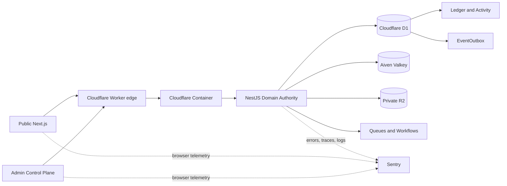
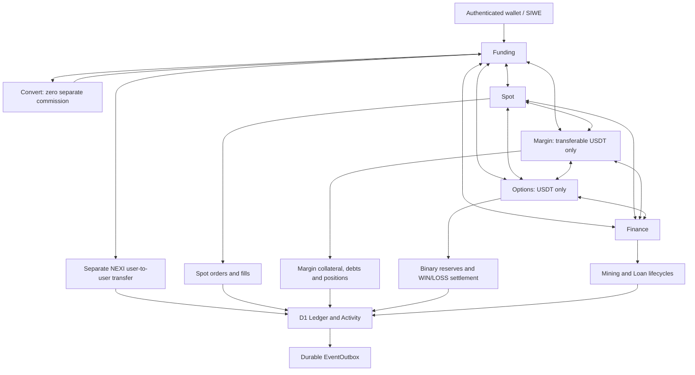
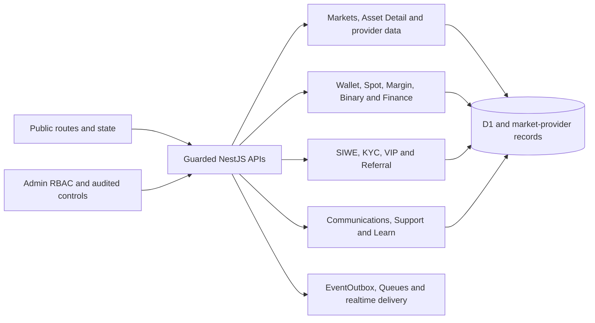
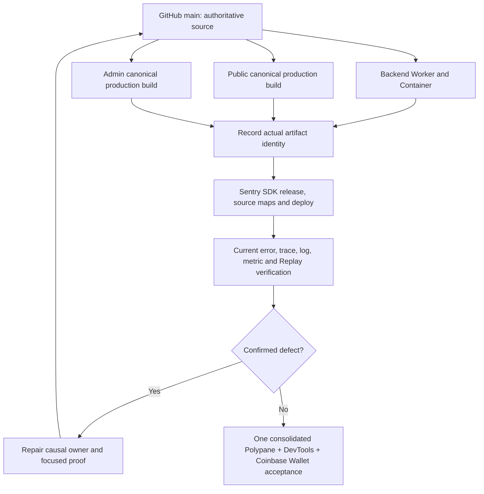
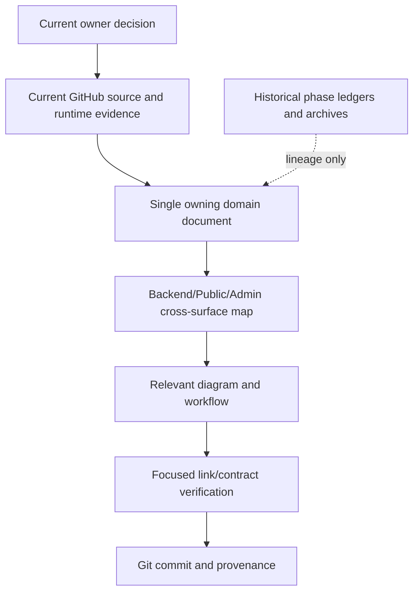

# NEXI Architecture and Workflow Diagrams

These Mermaid diagrams are versioned source documentation and render in GitHub Markdown. They describe current responsibility boundaries and approved flows, **not proof that every edge has passed runtime acceptance**. Verify actual source paths and deployed release identity before consequential changes.

## 1. Runtime and data ownership

NestJS and D1 own domain and durable truth respectively; the Ledger is accounting truth, EventOutbox publication truth, Valkey cache/realtime only, and Public/Admin have no direct financial database write authority. Cloudflare Observability remains disabled; Sentry SDK provides telemetry.

## 2. Financial accounts and transaction topology

**Constraint:** arrows between account pairs denote eligible transfer directions only, subject to account ownership, asset support, available funds, and reserve/loan restrictions. They do **not** imply that committed collateral or liabilities are freely movable, or that transfer automatically converts assets. User-facing Margin/Options transferable assets are USDT; legitimate non-USDT Margin liabilities remain accounted for internally. Overview aggregates genuine balances in estimated USDT equivalent without minting USDT or double counting.

## 3. Backend / Public / Admin feature responsibility

Use [cross-surface feature matrix](CROSS_SURFACE_FEATURE_MAP.md) for exact domain-to-route ownership and [Backend](../backend/README.md), [Public](../frontend/README.md), [Admin](../admin/README.md) for source paths.

## 4. Release, observability and acceptance sequence

The arrows represent the release procedure, **not a requirement to use one Git SHA for differently built artifacts**. Public, Backend and Admin runtime releases must each match their own actual build source. Browser validation is planned after source closure and deployment, using the existing authorized wallet profile rather than an obsolete MetaMask harness.

## 5. Current documentation lifecycle

Historical docs are recoverable from Git; do not revive them as live completion controllers. Update diagrams when architecture or routing changes, not for each transient process/release timestamp.

**Interactive companion:** [NEXI Architecture and Documentation Ownership mind map](https://mindmapai.app/canvas/d694e5a692fd022ace0b80cc4a437239956fb6bbb5cb833ffd00b1235783abda/edit) (owner-saved MindMap AI project; access may require its original account). Mapify can render the [documentation index](../README.md) as a hierarchy, but Git-hosted Markdown and Mermaid remain durable source authority.
