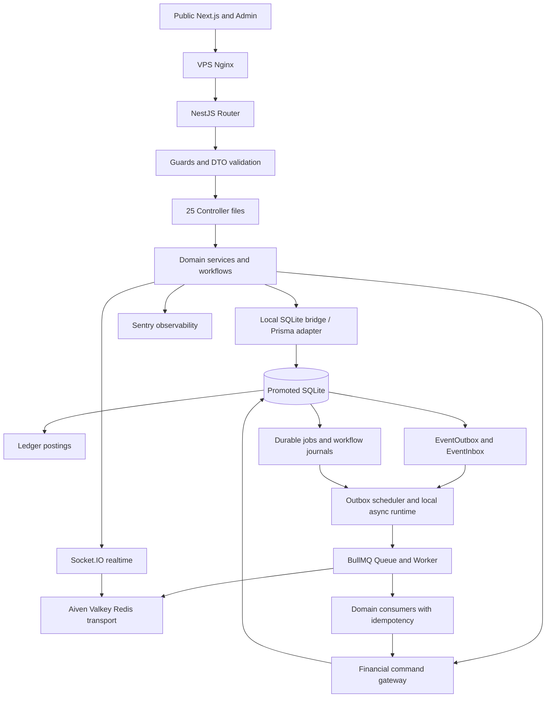

# NEXI backend API / routing / DTO / SQLite source map

> HISTORICAL SOURCE SNAPSHOT (2026-10-20): Generated from the then-current checkout and `docs/contracts/openapi.json`; this is not an up-to-date route contract. The listed legacy `communications/tickets`, recipient-selected messaging, and 223-path/245-operation snapshot predate the accepted Support/Messages ticket-retirement release. Do not use these rows as active API endpoints or generate clients from this snapshot. For current operations, inspect live controllers and regenerate the canonical OpenAPI with the installed NestJS generator only when required. Retain this file for historical evidence until a source-current replacement is accepted.

## Endpoint contract inventory

OpenAPI paths: 223; operations: 245; NestJS controllers found: 25; modules found: 30.

| HTTP | OpenAPI path | Operation ID | Tags |
|---|---|---|---|
| GET | `/` | `AppController_getHello` | Application |
| GET | `/market/proxy` | `AppController_getMarketData` | Application |
| GET | `/market/prices` | `AppController_getAllPrices` | Application |
| GET | `/health` | `AppController_getHealth` | Application |
| GET | `/healthz` | `AppController_getLiveness` | Application |
| GET | `/readyz` | `AppController_getReadiness` | Application |
| POST | `/feedback/upload` | `FeedbackController_uploadFeedback` | Feedback |
| POST | `/communications/tickets` | `CommunicationsController_createTicket` | Communications |
| GET | `/communications/tickets` | `CommunicationsController_tickets` | Communications |
| POST | `/communications/tickets/{id}/replies` | `CommunicationsController_reply` | Communications |
| POST | `/communications/tickets/{id}/assign` | `CommunicationsController_assign` | Communications |
| POST | `/communications/messages` | `CommunicationsController_message` | Communications |
| GET | `/communications/messages` | `CommunicationsController_messages` | Communications |
| POST | `/communications/messages/{id}/read` | `CommunicationsController_readMessage` | Communications |
| GET | `/communications/conversations` | `CommunicationsController_conversations` | Communications |
| POST | `/communications/conversations/{id}/report` | `CommunicationsController_reportConversation` | Communications |
| GET | `/communications/notifications` | `CommunicationsController_notifications` | Communications |
| POST | `/communications/notifications/{id}/read` | `CommunicationsController_read` | Communications |
| GET | `/communications/announcements` | `CommunicationsController_announcements` | Communications |
| GET | `/communications/learn` | `CommunicationsController_learn` | Communications |
| GET | `/communications/learn/categories` | `CommunicationsController_learnCategories` | Communications |
| GET | `/communications/learn/{slug}` | `CommunicationsController_learnDetail` | Communications |
| POST | `/communications/admin/announcements` | `CommunicationsController_createAnnouncement` | Communications |
| PATCH | `/communications/admin/announcements/{id}` | `CommunicationsController_updateAnnouncement` | Communications |
| POST | `/communications/admin/announcements/{id}/publish` | `CommunicationsController_publishAnnouncement` | Communications |
| GET | `/communications/admin/messages` | `CommunicationsController_adminMessages` | Communications |
| GET | `/communications/admin/messages/moderation` | `CommunicationsController_adminMessageModeration` | Communications |
| PATCH | `/communications/admin/messages/moderation/{id}` | `CommunicationsController_resolveMessageModeration` | Communications |
| GET | `/communications/admin/notifications` | `CommunicationsController_adminNotifications` | Communications |
| POST | `/communications/admin/notifications` | `CommunicationsController_sendAdminNotification` | Communications |
| GET | `/communications/admin/learn/articles` | `CommunicationsController_adminLearnArticles` | Communications |
| POST | `/communications/admin/learn/categories` | `CommunicationsController_createLearnCategory` | Communications |
| POST | `/communications/admin/learn` | `CommunicationsController_createLearn` | Communications |
| PATCH | `/communications/admin/learn/{id}` | `CommunicationsController_updateLearn` | Communications |
| POST | `/communications/admin/learn/{id}/publish` | `CommunicationsController_publishLearn` | Communications |
| POST | `/auth/wallet/challenge` | `AuthController_walletChallenge` | Authentication |
| POST | `/auth/wallet/verify` | `AuthController_walletVerify` | Authentication |
| GET | `/auth/me` | `AuthController_me` | Authentication |
| PATCH | `/auth/me` | `AuthController_updateMe` | Authentication |
| GET | `/auth/preferences` | `AuthController_preferences` | Authentication |
| PATCH | `/auth/preferences` | `AuthController_updatePreferences` | Authentication |
| GET | `/auth/sessions` | `AuthController_sessions` | Authentication |
| POST | `/auth/sessions/{sessionId}/revoke` | `AuthController_revokeSession` | Authentication |
| POST | `/auth/refresh` | `AuthController_refresh` | Authentication |
| POST | `/auth/logout` | `AuthController_logout` | Authentication |
| POST | `/auth/logout-all` | `AuthController_logoutAll` | Authentication |
| POST | `/auth/security/password/change` | `AuthController_changeSecurityPassword` | Authentication |
| POST | `/auth/security/mfa/setup` | `AuthController_setupMfa` | Authentication |
| POST | `/auth/security/mfa/verify` | `AuthController_verifyMfa` | Authentication |
| POST | `/auth/security/mfa/disable` | `AuthController_disableMfa` | Authentication |
| POST | `/auth/security/mfa/backup-codes` | `AuthController_generateBackupCodes` | Authentication |
| GET | `/auth/security/mfa/status` | `AuthController_mfaStatus` | Authentication |
| GET | `/auth/security/status` | `AuthController_securityStatus` | Authentication |
| GET | `/referral/me` | `ReferralVipController_referral` | Referral and VIP |
| GET | `/referral/history` | `ReferralVipController_referralHistory` | Referral and VIP |
| POST | `/referral/claim` | `ReferralVipController_claim` | Referral and VIP |
| GET | `/vip/me` | `ReferralVipController_vip` | Referral and VIP |
| GET | `/vip/levels` | `ReferralVipController_levels` | Referral and VIP |
| POST | `/_internal/events/queue` | `EventsController_ingestQueue` | Internal Events |
| GET | `/wallet/currencies/list` | `WalletController_getCurrencies` | Wallet |
| GET | `/wallet/activity` | `WalletController_getActivity` | Wallet |
| GET | `/wallet/overview` | `WalletController_getOverview` | Wallet |
| GET | `/wallet/me` | `WalletController_getMyWallet` | Wallet |
| GET | `/wallet/me/ledger` | `WalletController_getMyLedger` | Wallet |
| GET | `/wallet/{userId}` | `WalletController_getWallet` | Wallet |
| GET | `/wallet/{userId}/ledger` | `WalletController_getLedger` | Wallet |
| POST | `/wallet/deposit` | `WalletController_deposit` | Wallet |
| POST | `/wallet/withdraw` | `WalletController_withdraw` | Wallet |
| POST | `/wallet/admin/credit` | `WalletController_adminCredit` | Wallet |
| POST | `/wallet/admin/debit` | `WalletController_adminDebit` | Wallet |
| GET | `/wallet/admin/withdrawals` | `WalletController_getPendingWithdrawals` | Wallet |
| POST | `/wallet/admin/withdrawals/approve` | `WalletController_approveWithdrawal` | Wallet |
| POST | `/wallet/admin/withdrawals/reject` | `WalletController_rejectWithdrawal` | Wallet |
| GET | `/binary/config` | `BinaryController_getConfig` | Binary Options |
| POST | `/binary/position` | `BinaryController_openPosition` | Binary Options |
| POST | `/binary/settle` | `BinaryController_settlePosition` | Binary Options |
| GET | `/binary/positions/current` | `BinaryController_currentPositions` | Binary Options |
| GET | `/binary/positions/history` | `BinaryController_history` | Binary Options |
| POST | `/spot/order` | `SpotController_placeOrder` | Spot Trading |
| POST | `/spot/cancel` | `SpotController_cancelOrder` | Spot Trading |
| GET | `/spot/orderbook` | `SpotController_getOrderBook` | Spot Trading |
| GET | `/spot/market-trades` | `SpotController_getMarketTrades` | Spot Trading |
| GET | `/spot/orders/open` | `SpotController_getOpenOrders` | Spot Trading |
| GET | `/spot/orders/history` | `SpotController_getOrderHistory` | Spot Trading |
| GET | `/spot/trades/history` | `SpotController_getTradeHistory` | Spot Trading |
| GET | `/spot/margin/quote` | `MarginController_getQuote` | Margin Trading |
| GET | `/spot/margin/positions` | `MarginController_listPositions` | Margin Trading |
| POST | `/spot/margin/positions` | `MarginController_openPosition` | Margin Trading |
| POST | `/spot/margin/positions/{positionId}/cancel-pending` | `MarginController_cancelPendingPosition` | Margin Trading |
| POST | `/spot/margin/positions/{positionId}/close` | `MarginController_closePosition` | Margin Trading |
| POST | `/spot/margin/positions/mark` | `MarginController_markPosition` | Margin Trading |
| POST | `/spot/margin/positions/{positionId}/liquidate` | `MarginController_liquidatePosition` | Margin Trading |
| POST | `/spot/margin/transfer` | `MarginController_transfer` | Margin Trading |
| POST | `/spot/margin/borrows/orphan/repay` | `MarginController_repayUnmatchedBorrow` | Margin Trading |
| GET | `/spot/margin/activity` | `MarginController_history` | Margin Trading |
| GET | `/market/klines` | `MarketKlineController_list` | Market Data |
| GET | `/market/assets` | `MarketPublicController_listAssets` | Market Data |
| GET | `/market/assets/{symbol}` | `MarketPublicController_getAsset` | Market Data |
| GET | `/market/provider-state` | `MarketPublicController_providerState` | Market Data |
| GET | `/market/depth` | `MarketPublicController_depth` | Market Data |
| GET | `/market/trades` | `MarketPublicController_trades` | Market Data |
| GET | `/mining/plans` | `MiningController_getPlans` | Mining |
| GET | `/mining/summary` | `MiningController_getSummary` | Mining |
| GET | `/mining/rewards/{userId}` | `MiningController_getRewards` | Mining |
| POST | `/mining/subscribe` | `MiningController_subscribe` | Mining |
| GET | `/mining/my/{userId}` | `MiningController_getMySubs` | Mining |
| POST | `/mining/redeem` | `MiningController_redeem` | Mining |
| POST | `/mining/cancel` | `MiningController_cancel` | Mining |
| POST | `/mining/admin/plan` | `MiningController_createPlan` | Mining |
| POST | `/mining/admin/distribute` | `MiningController_forceDistribute` | Mining |
| GET | `/loans/plans` | `LoansController_getPlans` | Loans |
| POST | `/loans/apply` | `LoansController_apply` | Loans |
| GET | `/loans/my/{userId}` | `LoansController_getMyLoans` | Loans |
| GET | `/loans/admin/all` | `LoansController_getAllLoans` | Loans |
| POST | `/loans/admin/approve` | `LoansController_approve` | Loans |
| POST | `/loans/admin/reject` | `LoansController_reject` | Loans |
| POST | `/loans/repay` | `LoansController_repay` | Loans |
| POST | `/kyc/evidence` | `KycController_uploadEvidence` | KYC |
| POST | `/kyc/submit` | `KycController_submitKyc` | KYC |
| GET | `/kyc/status` | `KycController_getMyStatus` | KYC |
| GET | `/kyc/status/{userId}` | `KycController_getStatus` | KYC |
| GET | `/conversion/rate` | `ConversionController_getRate` | Conversion |
| POST | `/conversion/convert` | `ConversionController_convert` | Conversion |
| POST | `/conversion/admin/rate` | `ConversionController_setRate` | Conversion |
| GET | `/admin/me` | `AdminController_getAdminIdentity` | Admin Control Plane |
| GET | `/admin/roles` | `AdminController_listAdminRoleDefinitions` | Admin Control Plane |
| GET | `/admin/admins` | `AdminController_listAdminAccounts` | Admin Control Plane |
| GET | `/admin/admins/{id}` | `AdminController_getAdminAccount` | Admin Control Plane |
| GET | `/admin/audit` | `AdminController_listAdminAudit` | Admin Control Plane |
| GET | `/admin/incidents` | `AdminController_listIncidents` | Admin Control Plane |
| POST | `/admin/incidents/{id}/acknowledge` | `AdminController_acknowledgeIncident` | Admin Control Plane |
| POST | `/admin/tickets/{id}/reply` | `AdminController_replyAdminTicket` | Admin Control Plane |
| POST | `/admin/tickets/{id}/status` | `AdminController_setAdminTicketStatus` | Admin Control Plane |
| GET | `/admin/maintenance-windows` | `AdminController_listMaintenanceWindows` | Admin Control Plane |
| POST | `/admin/maintenance-windows` | `AdminController_createMaintenanceWindow` | Admin Control Plane |
| POST | `/admin/maintenance-windows/{id}/cancel` | `AdminController_cancelMaintenanceWindow` | Admin Control Plane |
| GET | `/admin/stats` | `AdminController_getStats` | Admin Control Plane |
| GET | `/admin/system-config` | `AdminController_getSystemConfig` | Admin Control Plane |
| POST | `/admin/system-config` | `AdminController_updateSystemConfig` | Admin Control Plane |
| GET | `/admin/governance/commands` | `AdminController_listGovernanceCommands` | Admin Control Plane |
| POST | `/admin/governance/commands` | `AdminController_createGovernanceCommand` | Admin Control Plane |
| POST | `/admin/governance/commands/{id}/approve` | `AdminController_approveGovernanceCommand` | Admin Control Plane |
| POST | `/admin/governance/commands/{id}/reject` | `AdminController_rejectGovernanceCommand` | Admin Control Plane |
| GET | `/admin/feature-flags` | `AdminController_listFeatureFlags` | Admin Control Plane |
| POST | `/admin/feature-flags` | `AdminController_updateFeatureFlag` | Admin Control Plane |
| POST | `/admin/financial-corrections` | `AdminController_applyFinancialCorrection` | Admin Control Plane |
| POST | `/admin/sandbox/controls` | `AdminController_requestSandboxControl` | Admin Control Plane |
| POST | `/admin/sandbox/controls/{id}/execute` | `AdminController_executeSandboxControl` | Admin Control Plane |
| GET | `/admin/users` | `AdminController_getUsers` | Admin Control Plane |
| GET | `/admin/kyc` | `AdminController_getKycReviews` | Admin Control Plane |
| GET | `/admin/kyc/{userId}/evidence/{side}` | `AdminController_getKycEvidence` | Admin Control Plane |
| POST | `/admin/kyc/decision` | `AdminController_decideKyc` | Admin Control Plane |
| GET | `/admin/sessions` | `AdminController_getAuthSessions` | Admin Control Plane |
| POST | `/admin/sessions/{id}/revoke` | `AdminController_revokeAuthSession` | Admin Control Plane |
| POST | `/admin/users/{id}/sessions/revoke` | `AdminController_revokeUserSessions` | Admin Control Plane |
| GET | `/admin/currencies` | `AdminController_getCurrencies` | Admin Control Plane |
| POST | `/admin/currencies` | `AdminController_createCurrency` | Admin Control Plane |
| GET | `/admin/market/assets` | `AdminController_getMarketAssets` | Admin Control Plane |
| POST | `/admin/market/assets/visibility` | `AdminController_setMarketAssetVisibility` | Admin Control Plane |
| GET | `/admin/market/networks` | `AdminController_getMarketNetworks` | Admin Control Plane |
| POST | `/admin/market/networks/visibility` | `AdminController_setMarketNetworkVisibility` | Admin Control Plane |
| GET | `/admin/market/feeds` | `AdminController_getMarketFeeds` | Admin Control Plane |
| GET | `/admin/market/runtime` | `AdminController_getMarketRuntime` | Admin Control Plane |
| POST | `/admin/market/feeds/status` | `AdminController_setMarketFeedStatus` | Admin Control Plane |
| GET | `/admin/spot/pairs` | `AdminController_getSpotPairs` | Admin Control Plane |
| GET | `/admin/spot/orders` | `AdminController_getSpotOrders` | Admin Control Plane |
| GET | `/admin/spot/margin/config` | `AdminController_getMarginConfiguration` | Admin Control Plane |
| POST | `/admin/spot/margin/config` | `AdminController_updateMarginConfiguration` | Admin Control Plane |
| POST | `/admin/spot/orders/{id}/cancel` | `AdminController_cancelAdminSpotOrder` | Admin Control Plane |
| POST | `/admin/spot/pairs/maintenance` | `AdminController_setSpotPairMaintenance` | Admin Control Plane |
| GET | `/admin/binary/positions` | `AdminController_getBinaryPositions` | Admin Control Plane |
| GET | `/admin/binary/settlements` | `AdminController_getBinarySettlements` | Admin Control Plane |
| POST | `/admin/binary/positions/{id}/settle` | `AdminController_settleBinaryPosition` | Admin Control Plane |
| POST | `/admin/binary/pairs/maintenance` | `AdminController_setBinaryPairMaintenance` | Admin Control Plane |
| GET | `/admin/wallets` | `AdminController_getAdminWallets` | Admin Control Plane |
| GET | `/admin/ledger` | `AdminController_getAdminLedger` | Admin Control Plane |
| GET | `/admin/deposits` | `AdminController_getAdminDeposits` | Admin Control Plane |
| GET | `/admin/deposit-claims` | `AdminController_getAdminDepositClaims` | Admin Control Plane |
| POST | `/admin/deposit-claims/{id}/confirm` | `AdminController_confirmDepositClaim` | Admin Control Plane |
| POST | `/admin/deposit-claims/{id}/credit` | `AdminController_creditDepositClaim` | Admin Control Plane |
| POST | `/admin/deposit-claims/{id}/reject` | `AdminController_rejectDepositClaim` | Admin Control Plane |
| POST | `/admin/deposits/{id}/confirm` | `AdminController_confirmAdminDeposit` | Admin Control Plane |
| POST | `/admin/deposits/{id}/credit` | `AdminController_creditAdminDeposit` | Admin Control Plane |
| POST | `/admin/deposits/{id}/fail` | `AdminController_failAdminDeposit` | Admin Control Plane |
| GET | `/admin/withdrawals` | `AdminController_getAdminWithdrawals` | Admin Control Plane |
| POST | `/admin/withdrawals/{id}/approve` | `AdminController_approveAdminWithdrawal` | Admin Control Plane |
| POST | `/admin/withdrawals/{id}/reject` | `AdminController_rejectAdminWithdrawal` | Admin Control Plane |
| POST | `/admin/withdrawals/{id}/review` | `AdminController_requestAdminWithdrawalReview` | Admin Control Plane |
| POST | `/admin/withdrawals/{id}/review/return` | `AdminController_returnAdminWithdrawalFromReview` | Admin Control Plane |
| POST | `/admin/withdrawals/{id}/fail` | `AdminController_failAdminWithdrawal` | Admin Control Plane |
| GET | `/admin/tickets` | `AdminController_getAdminTickets` | Admin Control Plane |
| GET | `/admin/announcements` | `AdminController_getAdminAnnouncements` | Admin Control Plane |
| PATCH | `/admin/currencies/{id}` | `AdminController_updateCurrency` | Admin Control Plane |
| POST | `/admin/currencies/{id}/address` | `AdminController_addDepositAddress` | Admin Control Plane |
| POST | `/admin/address/{id}/disable` | `AdminController_deleteDepositAddress` | Admin Control Plane |
| GET | `/admin/wallet-networks` | `AdminController_getWalletNetworks` | Admin Control Plane |
| POST | `/admin/wallet-networks` | `AdminController_createWalletNetwork` | Admin Control Plane |
| PATCH | `/admin/wallet-networks/{id}` | `AdminController_updateWalletNetwork` | Admin Control Plane |
| PATCH | `/admin/address/{id}/state` | `AdminController_updateDepositAddressState` | Admin Control Plane |
| GET | `/admin/mining-plans` | `AdminController_getMiningPlans` | Admin Control Plane |
| POST | `/admin/mining-plans` | `AdminController_createMiningPlan` | Admin Control Plane |
| PATCH | `/admin/mining-plans/{id}` | `AdminController_updateMiningPlan` | Admin Control Plane |
| GET | `/admin/loan-plans` | `AdminController_getLoanPlans` | Admin Control Plane |
| POST | `/admin/loan-plans` | `AdminController_createLoanPlan` | Admin Control Plane |
| PATCH | `/admin/loan-plans/{id}` | `AdminController_updateLoanPlan` | Admin Control Plane |
| GET | `/admin/mining/subscriptions` | `AdminController_getMiningSubscriptions` | Admin Control Plane |
| GET | `/admin/loans/applications` | `AdminController_getLoanApplications` | Admin Control Plane |
| POST | `/admin/loans/applications/{id}/approve` | `AdminController_approveLoanApplication` | Admin Control Plane |
| POST | `/admin/loans/applications/{id}/reject` | `AdminController_rejectLoanApplication` | Admin Control Plane |
| GET | `/admin/risk/pairs` | `AdminController_getBinaryPairs` | Admin Control Plane |
| GET | `/admin/binary/config` | `AdminController_getBinaryConfiguration` | Admin Control Plane |
| POST | `/admin/binary/config` | `AdminController_updateBinaryConfiguration` | Admin Control Plane |
| POST | `/admin/auth/login` | `AdminAuthController_login` | Admin Authentication |
| POST | `/admin/auth/refresh` | `AdminAuthController_refresh` | Admin Authentication |
| POST | `/admin/auth/logout` | `AdminAuthController_logout` | Admin Authentication |
| POST | `/admin/auth/logout-all` | `AdminAuthController_logoutAll` | Admin Authentication |
| GET | `/admin/referrals` | `ReferralVipAdminController_referrals` | Admin Referral and VIP |
| GET | `/admin/vip/users` | `ReferralVipAdminController_users` | Admin Referral and VIP |
| GET | `/admin/vip/levels` | `ReferralVipAdminController_levels` | Admin Referral and VIP |
| POST | `/admin/vip/levels` | `ReferralVipAdminController_upsertLevel` | Admin Referral and VIP |
| POST | `/admin/vip/assign` | `ReferralVipAdminController_assign` | Admin Referral and VIP |
| POST | `/financial/withdrawals` | `FinancialOperationsController_requestWithdrawal` | Financial Operations |
| GET | `/financial/withdrawals` | `FinancialOperationsController_withdrawals` | Financial Operations |
| POST | `/financial/account-transfers` | `FinancialOperationsController_transferBetweenAccounts` | Financial Operations |
| POST | `/financial/transfers` | `FinancialOperationsController_transfer` | Financial Operations |
| GET | `/financial/transfers` | `FinancialOperationsController_transfers` | Financial Operations |
| POST | `/financial/conversion/quote` | `FinancialOperationsController_quote` | Financial Operations |
| POST | `/financial/conversion/accept` | `FinancialOperationsController_accept` | Financial Operations |
| GET | `/financial/deposits` | `FinancialOperationsController_deposits` | Financial Operations |
| GET | `/financial/deposit-destinations` | `FinancialOperationsController_getDepositDestinations` | Financial Operations |
| POST | `/financial/deposit-proof-intents` | `FinancialOperationsController_createDepositProofIntent` | Financial Operations |
| POST | `/financial/deposit-proof-upload/authorize` | `FinancialOperationsController_authorizeDepositProofUpload` | Financial Operations |
| POST | `/financial/deposit-claims` | `FinancialOperationsController_submitDepositClaim` | Financial Operations |
| GET | `/financial/deposit-claims` | `FinancialOperationsController_getDepositClaims` | Financial Operations |
| POST | `/financial/admin/withdrawals/approve` | `FinancialOperationsController_approve` | Financial Operations |
| POST | `/financial/admin/withdrawals/reject` | `FinancialOperationsController_reject` | Financial Operations |
| POST | `/financial/admin/withdrawals/settle` | `FinancialOperationsController_settle` | Financial Operations |
| PUT | `/storage/deposit-proof` | `LocalDepositProofController_upload` | LocalDepositProof |
| GET | `/ops/live` | `HealthController_live` | Operations |
| GET | `/ops/ready` | `HealthController_ready` | Operations |
| POST | `/_internal/workflows/{workflow}/{action}` | `WorkflowCommandsController_execute` | Internal Workflows |
| GET | `/profile/me` | `ProfileController_getMe` | Profile |
| PATCH | `/profile/me` | `ProfileController_updateMe` | Profile |
| GET | `/profile/preferences` | `ProfileController_preferences` | Profile |
| PATCH | `/profile/preferences` | `ProfileController_updatePreferences` | Profile |

## Controller / request-validation / DTO inventory

| Controller source | Route prefix | Decorator routes | DTO imports |
|---|---|---|---|
| `backend/src/admin/admin-auth.controller.ts` | `admin/auth` | `Post login`, `Post refresh`, `Post logout`, `Post logout-all` | `../auth/auth.dto` |
| `backend/src/admin/admin.controller.ts` | `admin` | `Get me`, `Get roles`, `Get admins`, `Get admins/:id`, `Get audit`, `Get incidents`, `Post incidents/:id/acknowledge`, `Post tickets/:id/reply`, `Post tickets/:id/status` … | `../loans/loans.dto`, `./admin.dto` |
| `backend/src/app.controller.ts` | `/` | `Get `, `Get market/proxy`, `Get market/prices`, `Get health`, `Get healthz`, `Get readyz` |  |
| `backend/src/auth/auth.controller.ts` | `auth` | `Post wallet/challenge`, `Post wallet/verify`, `Get me`, `Patch me`, `Get preferences`, `Patch preferences`, `Get sessions`, `Post sessions/:sessionId/revoke`, `Post refresh` … | `./auth.dto` |
| `backend/src/binary/binary.controller.ts` | `binary` | `Get config`, `Post position`, `Post settle`, `Get positions/current`, `Get positions/history` | `./binary.dto` |
| `backend/src/communications/communications.controller.ts` | `communications` | `Post tickets`, `Get tickets`, `Post tickets/:id/replies`, `Post tickets/:id/assign`, `Post messages`, `Post messages/:id/read`, `Get messages`, `Get conversations`, `Post conversations/:id/report` … | `./communications.dto` |
| `backend/src/contract/contract.controller.ts` | `lever` | `Post deal`, `Post setstop`, `Post close`, `Get my_trade` | `./contract.dto` |
| `backend/src/conversion/conversion.controller.ts` | `conversion` | `Get rate`, `Post convert`, `Post admin/rate` | `./conversion.dto` |
| `backend/src/events/events.controller.ts` | `_internal/events` | `Post queue` |  |
| `backend/src/feedback/feedback.controller.ts` | `feedback` | `Post upload` | `./feedback.dto` |
| `backend/src/financial/financial-operations.controller.ts` | `financial` | `Post withdrawals`, `Post account-transfers`, `Post transfers`, `Post conversion/quote`, `Post conversion/accept`, `Get deposits`, `Get deposit-destinations`, `Post deposit-proof-intents`, `Post deposit-proof-upload/authorize` … | `./financial-operations.dto` |
| `backend/src/financial/local-deposit-proof.controller.ts` | `storage` | `Put deposit-proof` |  |
| `backend/src/kyc/kyc.controller.ts` | `kyc` | `Post evidence`, `Post submit`, `Get status`, `Get status/:userId` | `../auth/auth.dto` |
| `backend/src/loans/loans.controller.ts` | `loans` | `Get plans`, `Post apply`, `Get my/:userId`, `Get admin/all`, `Post admin/approve`, `Post admin/reject`, `Post repay` | `./loans.dto` |
| `backend/src/market/market-kline.controller.ts` | `market` | `Get klines` | `./market-kline.dto` |
| `backend/src/market/market-public.controller.ts` | `market` | `Get assets`, `Get assets/:symbol`, `Get provider-state`, `Get depth`, `Get trades` |  |
| `backend/src/mining/mining.controller.ts` | `mining` | `Get plans`, `Get summary`, `Get rewards/:userId`, `Post subscribe`, `Get my/:userId`, `Post redeem`, `Post cancel`, `Post admin/plan`, `Post admin/distribute` | `./mining.dto` |
| `backend/src/observability/health.controller.ts` | `ops` | `Get live`, `Get ready` |  |
| `backend/src/profile/profile.controller.ts` | `profile` | `Get me`, `Patch me`, `Get preferences`, `Patch preferences` | `./profile.dto` |
| `backend/src/referral-vip/referral-vip-admin.controller.ts` | `admin` | `Get referrals`, `Get vip/users`, `Get vip/levels`, `Post vip/levels`, `Post vip/assign` | `./referral-vip.dto` |
| `backend/src/referral-vip/referral-vip.controller.ts` | `/` | `Get referral/me`, `Get referral/history`, `Post referral/claim`, `Get vip/me`, `Get vip/levels` | `./referral-vip.dto` |
| `backend/src/spot/margin.controller.ts` | `spot/margin` | `Get quote`, `Get positions`, `Post positions`, `Post positions/:positionId/cancel-pending`, `Post positions/:positionId/close`, `Post positions/mark`, `Post positions/:positionId/liquidate`, `Post transfer`, `Post borrows/orphan/repay` … | `./margin.dto` |
| `backend/src/spot/spot.controller.ts` | `spot` | `Post order`, `Post cancel`, `Get orderbook`, `Get market-trades`, `Get orders/open`, `Get orders/history`, `Get trades/history` | `./spot.dto` |
| `backend/src/wallet/wallet.controller.ts` | `wallet` | `Get currencies/list`, `Get activity`, `Get overview`, `Get me`, `Get me/ledger`, `Get :userId`, `Get :userId/ledger`, `Post deposit`, `Post withdraw` … | `./wallet.dto` |
| `backend/src/workflows/workflow-commands.controller.ts` | `_internal/workflows` | `Post :workflow/:action` | `./workflow-command.dto` |

## Source module registrations

- `backend/src/admin/admin.module.ts`
- `backend/src/app.module.ts`
- `backend/src/audit/audit.module.ts`
- `backend/src/auth/auth.module.ts`
- `backend/src/binary/binary.module.ts`
- `backend/src/communications/communications.module.ts`
- `backend/src/contract/contract.module.ts`
- `backend/src/conversion/conversion.module.ts`
- `backend/src/d1/d1-prisma.module.ts`
- `backend/src/d1/d1-worker-bridge.module.ts`
- `backend/src/events/events.module.ts`
- `backend/src/financial/financial-operations.module.ts`
- `backend/src/jobs/local-async.module.ts`
- `backend/src/kyc/kyc.module.ts`
- `backend/src/ledger/ledger.module.ts`
- `backend/src/loans/loans.module.ts`
- `backend/src/market/market.module.ts`
- `backend/src/mining/mining.module.ts`
- `backend/src/notification/notification.module.ts`
- `backend/src/observability/observability.module.ts`
- `backend/src/profile/profile.module.ts`
- `backend/src/redis/redis.module.ts`
- `backend/src/referral-vip/referral-vip.module.ts`
- `backend/src/risk/risk.module.ts`
- `backend/src/sandbox/sandbox.module.ts`
- `backend/src/settlement/settlement.module.ts`
- `backend/src/spot/spot.module.ts`
- `backend/src/users/users.module.ts`
- `backend/src/wallet/wallet.module.ts`
- `backend/src/workflows/workflow-commands.module.ts`

## SQLite and asynchronous ownership

- NestJS `AppModule` registers domain modules; Public/Admin route through Nginx and consume NestJS APIs.
- Controllers use DTO validation and delegate into domain services; confirm each route’s concrete service binding from source when changing it.
- `backend/src/d1/d1-prisma.service.ts` selects `PrismaBetterSqlite3` when `NEXI_SQLITE_LOCAL_ENABLED=true` and validates the absolute file path via `NEXI_LOCAL_SQLITE_PATH`. It initializes WAL, synchronous FULL, foreign keys and busy timeout per physical Prisma connection.
- `backend/src/d1/local-sqlite-bridge.service.ts` uses better-sqlite3 against the same configured local SQLite authority; financial batch and journal consumers use its bridge contract.
- `backend/src/d1/d1-financial-command.gateway.ts` owns the financial command SQL boundary. Preserve Ledger postings, idempotency and EventOutbox atomicity.
- `backend/src/events/event-outbox.service.ts`, scheduler and EventInbox represent durable publication/deduplication.
- `backend/src/jobs/local-durable-job.store.ts` and `backend/src/jobs/local-workflow.store.ts` persist asynchronous work; `local-async-runtime.service.ts` creates BullMQ Queue/Worker for wake-up/transport via Aiven Valkey.
- The code retains old D1-named adapter interfaces; these are live compatibility abstractions in source. Do not delete them by filename without replacing call sites.

## Architecture diagram

## Verification limits

Generated from source structures and the checked OpenAPI snapshot. Whether deployed controllers and OpenAPI share the same release identity remains a separate verification. Operations may map across multiple NestJS layers; use controller and service source, not naming guesses, for causal changes.
