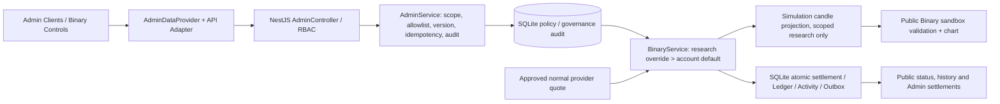

> **Committed source proof:** [Pre-build source and correctness record](../quality/NEXI_PREBUILD_ARCHITECTURE_SOURCE_PROOF_20261118.md), market `8d32b95a71ef`, Admin `ed9fbf5be171`; no new production deployment.

# NEXI — Current Source Architecture Authority (2026-11-18)

**Decision owner:** NEXI owner, November 18, 2026. **Current source baseline:** market commit `8d32b95a71ef` followed by Admin/test commit `ed9fbf5be171`, both preserved and committed; the original Work study was at `99ba7024a897`. **Decision:** current NEXI source code and approved Binary/Admin design are correct architecture authority. Dated document contradictions are *superseded as current requirements*, but remain intact as historical implementation/decision evidence. Any future source/design change requires fresh explicit owner direction. The old Kernel and blanket source-first test ban are retired.

**Evidence:** [30-source semantic crosswalk](NEXI_DEEP_ARCHITECTURE_SEMANTIC_RECONCILIATION_20261118.md), [older reconciliation and inventory](NEXI_ARCHITECTURE_DOCUMENT_RECONCILIATION_20261118.md), [system architecture](NEXI_SYSTEM_ARCHITECTURE.md), [cross-surface map](CROSS_SURFACE_FEATURE_MAP.md), [November 18 market ADR](ADR-2026-11-18-NEXI-MARKET-DATA-RESOURCE-ARCHITECTURE.md). Source paths below are mandatory verification anchors, not a guarantee that every runtime journey passed.

## Authoritative boundaries

| Responsibility | Current source owner | Contract and constraint |
|---|---|---|
| Public mobile Web3 application | `frontend/app/`, `frontend/app/lib/wallet-siwe.ts` | Customer-facing reader and command initiator, not money or audit authority; SIWE mainnet-only policy enforced at NestJS. |
| Admin desktop operator and navigation | `Admin/src/admin/config/navigation.ts`, `Admin/src/routes/`, `Admin/src/admin/data/{provider,nexi-api-provider}.ts` | Eight workspaces, 21 direct navigation items and 34 typed route names. UI permissions supplement but never replace Backend RBAC. |
| HTTP, identity and permissions | `backend/src/auth/`, `backend/src/admin/`, `backend/src/communications/` | NestJS DTO/guard/actor authorization. Public SIWE chain 1, strict origin and nonce replay policy; independently authenticated Admin. |
| Financial business policy and writes | `backend/src/financial/`, `backend/src/d1/d1-financial-command.gateway.ts`, `backend/src/d1/local-sqlite-bridge.service.ts` | LedgerAccount/LedgerPosting, immutable intent/idempotency, audit/activity/outbox/journal in single SQLite-backed controlled economic authority. Legacy D1 naming means local compatibility, not Cloudflare D1. |
| Durable asynchronous transport | `backend/src/jobs/`, `backend/src/events/`, `backend/src/prisma/redis-io.adapter.ts` | BullMQ/Aiven Valkey and Socket.IO distribute/retry/project committed state. Neither is financial source of truth. |
| Canonical market quotes/candles | `backend/src/market/market-provider-router.service.ts`, `market-ingest.service.ts`, `market-kline.service.ts`, `market.gateway.ts` | Canonical provider map, freshness and market provenance; persistent quotes/Klines distinguish best-effort trades/depth. No Binance partial depth20 assumption of incremental sequence. |
| Binary policy and lifecycle | `backend/src/admin/admin.controller.ts`, `backend/src/admin/admin.service.ts`, `backend/src/binary/binary.service.ts`, `backend/src/sandbox/` | Admin account default/position override: eligible research account allowlist, permission, original idempotency key, audit, optimistic version guard; normal provider-settled Binary stays separate from research simulation. |
| Binary simulation chart and outcome | `backend/src/binary/binary.service.ts:306-369`, `frontend/app/lib/binary-sandbox-chart.ts`, `frontend/app/dashboard/binary/page.tsx` | **Implemented producer-to-consumer contract:** Backend generates bounded deterministic research candles carrying entry/expiry/outcome provenance; Public validates direction/outcome, monotonic times/price continuity, aggregates to selected timeframe and renders the isolated sandbox feed. Final settlement uses atomic SQLite gateway; chart projection does not write money or override normal reference quotes. |
| Customer support and messages | `backend/src/communications/communications.controller.ts`, `Admin/src/routes/messages.tsx` | Canonical customer-to-Admin support thread. Recipient-selected `POST /communications/messages` deliberately returns 410; ticket creation/reply lifecycle is retired. |
| Operations, evidence and release | `docs/operations/`, `tasks/evidence/`, `docs/quality/` | Source implementation, static tests, deployed artifact, actual runtime and economic acceptance are distinct evidence tiers. November 18 market candidate is not November 17 deployment. |

## Binary/Admin canonical end-to-end trace

**Current source confirms the Binary research chart implementation.** Older A01–A14 tables and design PNG are dated specifications and may describe components as missing. The later source wins on *implementation existence*. Do not invent additional Binary-control code because an October map says it is absent. Runtime correctness, production parity and economic acceptance remain separate proof classes; this qualification is not a declaration that the approved architecture is deficient.

## November 18 market-data ADR: implemented versus conditional

The market repair is **committed in source** as `8d32b95a71ef` (11 previously modified tracked source/test/contract files plus the Postman collection). It is **not built or deployed**. Backend 8 concurrent primary event workers and 4 reference workers, 1,024 closed-candle queue allowance, 256 reference queue, ticker coalescing and replaceable depth, bounded shutdown handling, revised same-timestamp Kline persistence and Public BigInt recent-trade gap STALE/resnapshot logic are in source. The ADR's proposed redesign of the initial shared 256-event queue should not be listed as *still absent*. Remaining targets (long-run saturation statistics, SQLite financial interference under load, historical Kline retention policy, provider license decisions, Aiven network security changes) are **measured/owner decisions**, not source defects by default.

**Transport limitation:** even with source repair, trade/depth reference streams are lossy, REST trades return latest 50 by default/100 max, and 5-second shutdown grace cannot guarantee every queued event is persisted. None is financial posting authority. No unapproved market-store migration, extra paid service, settlement fallback or production change is authorized by this document.

## Source-level validation and proof tiers

1. Confirm current branch, HEAD and dirty files first. Do not replace the active 11-file market worktree.
2. Inspect exact source or Graphify source path plus direct current source. Graphify graph was built against an earlier commit and is a locator rather than present behavior proof.
3. `SOURCE_IMPLEMENTED` denotes current code present; `STATIC_VERIFIED` requires matching command/results; `DEPLOYED` requires exact artifact revision; `RUNTIME_VERIFIED` requires same-release observation; `ECONOMIC_VERIFIED` requires actual authorized durable ledger and consumer reconciliation.
4. `docs/contracts/openapi.json` is the current source-candidate HTTP reference (253 paths, 279 operations in reviewed snapshot); October 223-path listing and ticket endpoints are history. Postman 4-GET collection checked an older deployed release, not the market candidate.
5. Architecture rules are captured by Archkeel with explicit components, ownership and target rules. PASS in a scoped scan must not be represented as full Backend compliance; UNKNOWN is a legitimate verdict. Generated Prisma clients, backups and node_modules are out of authored-source scope.
6. Preserve the original 113 acceptance criteria and four owner-accepted-unverified economic gates as dated evidence. Do not claim current-release PASS from code or docs.

## Document reconciliation policy

All 30 documents in the six study directories, plus the original Admin Binary navigation diagram, are accounted for in the linked semantic crosswalk. Those documents are **not equal authority**: canonical requirements/CSV/evidence must retain original rows; dated snapshots remain labeled history; current cross-surface/system/market documentation must follow current sources and the owner's latest decisions. A superseding explanation should be additive rather than rewriting historical source evidence. Where this file disagrees with current source, inspect code and update this file—the file is not a competing implementation specification.

**Architecture proof limits:** Archkeel full-surface scans timed out and no global policy PASS was obtained; use the explicit owner-approved source ownership contract and checked tests/readbacks rather than inventing a green static report. Graphify/Fallow are supplemental and their dated scope limits remain. Product acceptance and production release are separate work. Application load testing, browser/mobile DApp acceptance, release and economic transactions are separate authorized campaigns.
