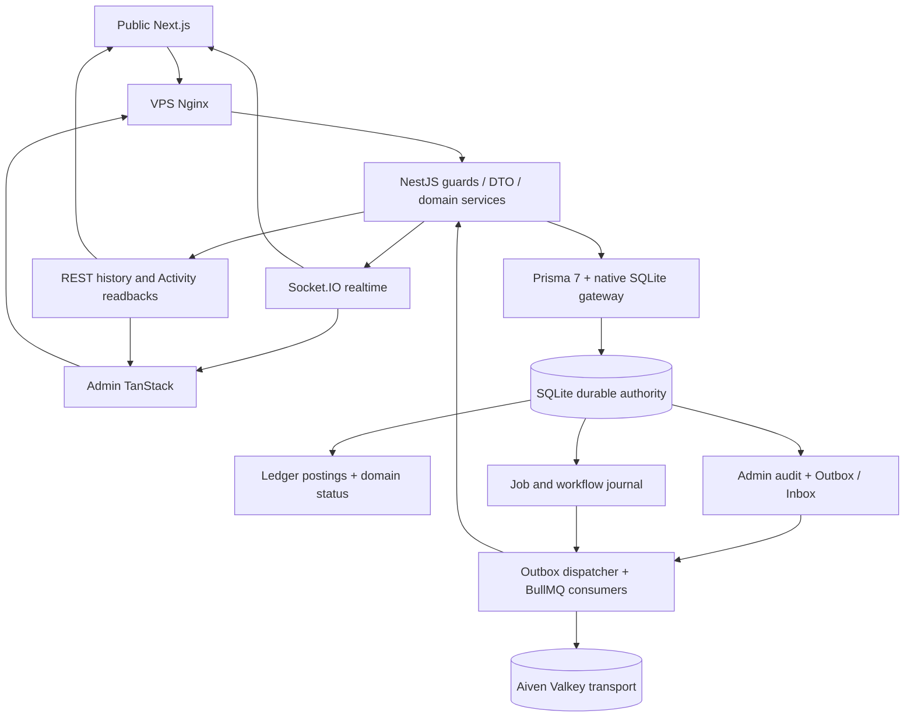

# NEXI system architecture — source-reconciled 2026-11-17

**Proof boundary:** Repository source at main HEAD 03cf396788d1897cd700a5edd5de55f065db6562 plus current working-tree changes. This is a SOURCE-ONLY description, not verification of deployed artifacts or running services. Source and owner decisions override historical snapshots.

## Three application surfaces

- **Public:** frontend/ — Next.js App Router 16.4.1, React 19.3.0; mobile-first wallet/SIWE, markets and charts, Funding/Spot/Margin/Options/Finance, conversion, deposits/withdrawals, trading, Earn/Mining, loans, notifications, messages, support, profile.
- **Admin:** Admin/ — TanStack Router/Query, React 19, Vite 8, Nitro; permission-gated desktop operator console. Configuration, reviews, financial corrections, settlements, asset/network controls, messages and audit are requests to Backend. The browser does not write the ledger.
- **Backend:** backend/src/app.module.ts — NestJS 12 domains for Auth, Wallet, Ledger, FinancialOperations/HTTP, Binary/Settlement, Spot/Margin, Conversion, Mining, Loans, KYC, Market, Admin, Communications, Notifications, Events, Risk, async jobs and workflows. Controllers/DTOs/guards validate; services enforce domain rules; transaction gateways persist authoritative effects.

## Runtime boundaries

Name.com DNS and VPS Nginx route www.nexitrading.app, admin.nexitrading.app and api.nexitrading.app to separate processes. One source checkout is /home/mellonelay1999/workspaces/Nexi. Recorded artifact owners: /srv/nexi/public/current/.next, /srv/nexi/admin/current and /srv/nexi/backend/dist; separate dependency stores exist at /srv/nexi/{public,admin,backend}/shared/node_modules. The October service and Node 24.21.0 reports are dated observations; current deployed SHA and service health have not been checked under this source-first request.

**SQLite is the financial authority.** D1PrismaService uses Prisma 7.10.1 and the better-sqlite3 adapter; the native local SQLite bridge handles atomic batches. Runtime source requires an existing absolute NEXI_LOCAL_SQLITE_PATH and NEXI_SQLITE_LOCAL_ENABLED=true; the previously promoted path was /var/lib/nexi/sqlite/nexi-staging.sqlite. LedgerAccount and LedgerPosting are accounting truth. NestJS policy and the financial command gateway own economic changes; Prisma and the native bridge are interfaces to the SAME durable store, not two financial writers. The historical D1- prefix names do not mean Cloudflare Worker/D1 is active.

**Async transport is subordinate to SQLite.** EventOutbox/EventInbox and local job/workflow journals hold durable intent, publication state and duplicate suppression. LocalAsyncRuntimeService defines BullMQ 6 queues domain-events, notifications and integration-jobs, transported through Aiven Valkey. Code registration is not proof that the configuration-gated runtime is active. Job delivery can be repeated; the original SQLite intent and unique journal/inbox identities must prevent repeated financial effects. Valkey is not a balance/ledger authority.

**Realtime is a projection.** NestJS Socket.IO emits scoped post-commit updates to Public/Admin; client resnapshot from authenticated REST/read models handles missed messages and reconnects. Socket events, cached amounts and success toasts do not prove a posted transaction.

## Canonical producer-to-consumer flow

1. The signed-in Public user or authorized Admin sends a request with its immutable economic intent and idempotency identity.
2. The NestJS controller authenticates/authorizes the actor and validates DTO/configuration; the domain owner checks balances, limits, settlement policy and the existing request receipt.
3. One SQLite transaction commits business state, LedgerAccount/LedgerPosting where financial, Admin audit where required, and EventOutbox. Unknown/failed writes must not be turned into client-confirmed success.
4. The dispatcher observes committed outbox/journal state and schedules BullMQ work; re-delivery verifies durable inbox/original intent before any consequential effect.
5. Socket.IO and REST/read models let Public and Admin reconcile authoritative state. Retries keep the same key for the same intent; changed payloads must not silently reuse a prior receipt.

## Domain ownership

| Capability | Backend authority | Consumers |
|---|---|---|
| SIWE, sessions, referral/VIP | auth/, users/, profile/, referral-vip/ | Public login/profile; Admin users/sessions |
| Markets, asset catalog, klines | market/ | Public charts and prices; Admin assets/market-feeds |
| Wallet, transfers, conversion | wallet/, financial/, conversion/, ledger/ | Public Wallet/Activity; Admin ledger/wallets/audit |
| Deposits and withdrawals | wallet/, financial/ and SQLite command gateway | Public Wallet; Admin deposits/withdrawals |
| Binary settlement | binary/, settlement/ and financial gateway | Public Binary; Admin binary/settlements |
| Spot and isolated Margin | spot/ and financial gateway | Public trading and positions; Admin spot/exposure |
| Earn/Mining and Loans | mining/, loans/, workflows/ | Public Finance; Admin mining/loans |
| Notifications, Messages, Learn | communications/, notification/, events/ | Public communications; Admin messaging/content/moderation |

## Observability, proof and release phase

Sentry, systemd/journald and Jaeger/OTLP appear in the recorded operations architecture. Earlier smoke traces prove collector/storage wiring only; they are not current end-to-end API trace proof. A server returning HTTP 200 or readiness does not prove settlement, precision, wallet account reconciliation, or browser acceptance.

Source navigation: local Graphify graph at graphify-out/graph.json and separate Knowledge v4 at /srv/nexi/engineering-knowledge/20261110/. Graphify query/explain/path/affected show static relationships, which must be checked against current dirty source. During this inspection graph.json contains 8,602 nodes / 20,904 edges; its built_at_commit is distinct from current uncommitted changes. Use the 2026-11-16 local Graphify CLI/MCPC runbook, not retired hosted Cloud tracing or the missing 2026-11-07 coverage document.

**Owner SOURCE-FIRST:** Complete evidence-proven Backend/Public/Admin source contracts and integrations before application tests, lint/typechecks, builds, browser acceptance, service restarts, migrations or deployment. The original 113 criteria and the dated 5/108 source association inventory belong to deferred browser acceptance under docs/quality/, not this source closure.

## Current references and historical boundaries

- [Cross-surface owner map](CROSS_SURFACE_FEATURE_MAP.md); [Admin route map](../../Admin/docs/TANSTACK_ARCHITECTURE_AND_ROUTE_MAP.md).
- [SQLite/BullMQ operations](../operations/NEXI_VPS_SQLITE_BULLMQ_RUNBOOK.md); [SQLite engine](../operations/NEXI_SQLITE_DATABASE_RUNBOOK.md); [Graphify CLI/MCPC](../operations/NEXI_GRAPHIFY_CLOUD_CLI_MCPC_RUNBOOK_20261116.md).
- [Current state](../../NEXI_CURRENT_STATE.md); [active taskboard](../../tasks/todo.md); [source proof matrix](../../tasks/evidence/NEXI_SOURCE_CLOSURE_MATRIX_20261109.md); [Admin replay crosswalk](../../tasks/evidence/ADMIN_MUTATION_IDEMPOTENCY_CROSSWALK_20261116.json).
- [Historical October 20 API source map](NEXI_BACKEND_API_SQLITE_SOURCE_MAP.md) and [historical VPS service observations](NEXI_VPS_BACKEND_RUNTIME.md) remain dated artifacts, not live API/runtime proof.
