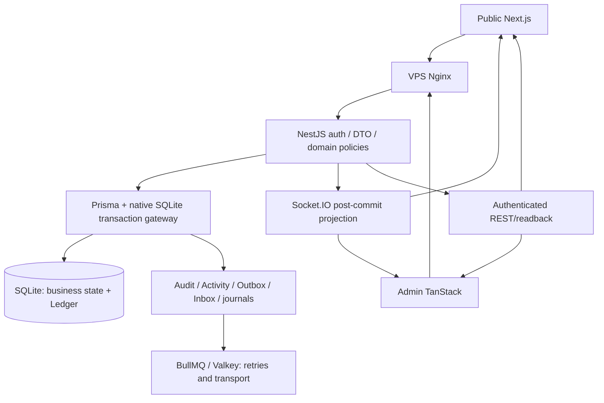
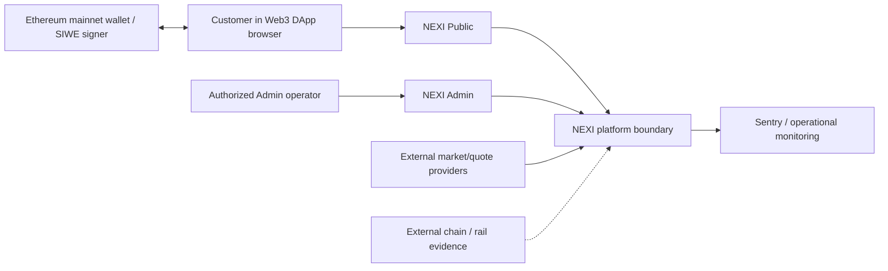
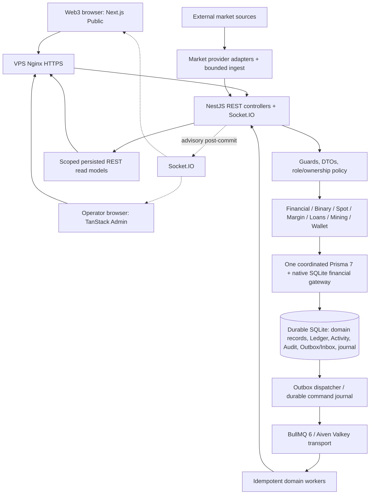
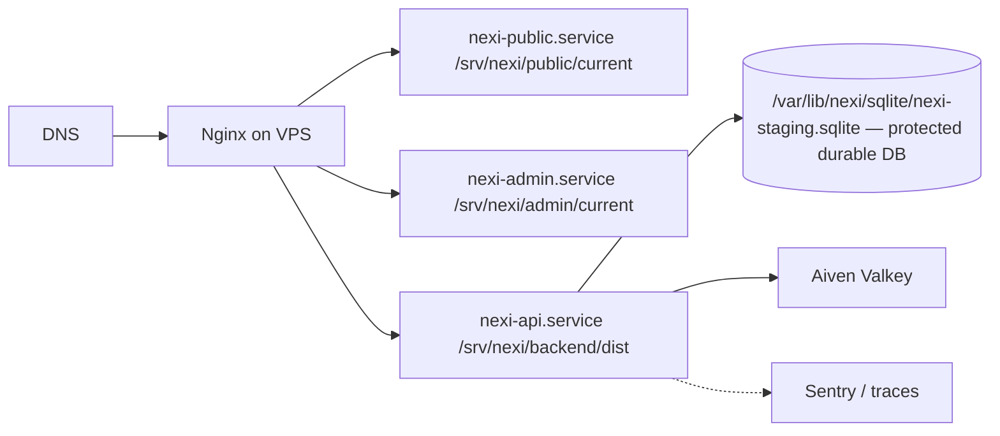
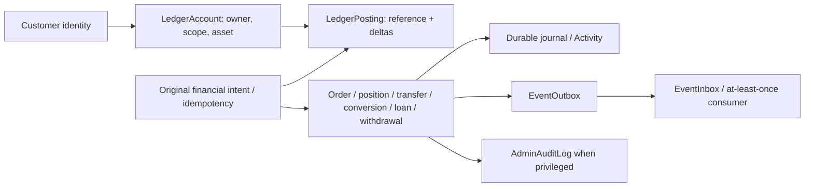
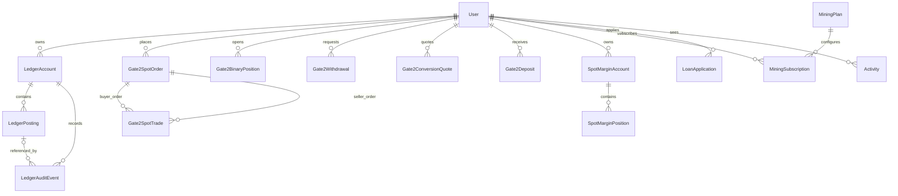
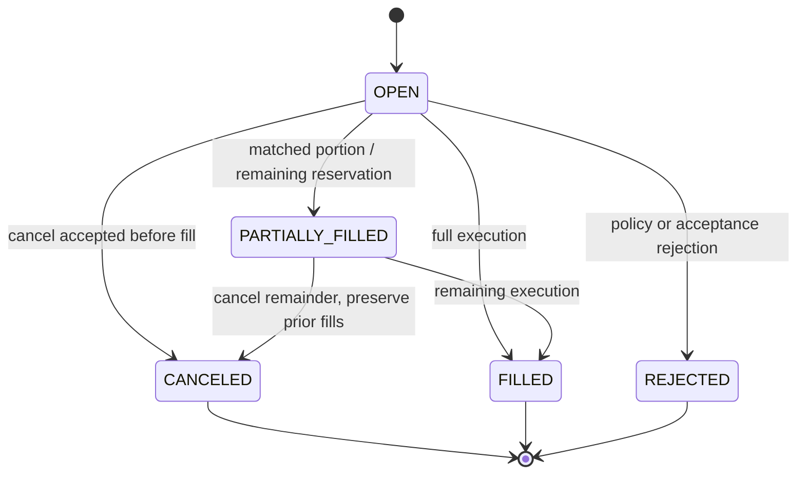
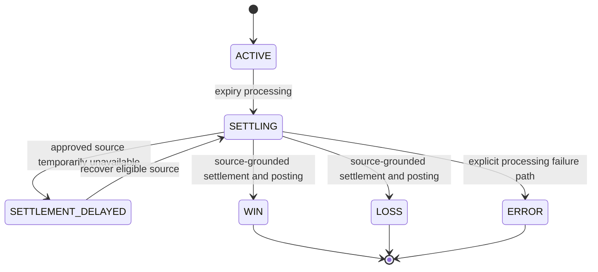

# NEXI — maintained three-surface architecture

**Reconciled 2026-11-19 (Singapore).** Owner decisions and actual source govern; this is a maintained architecture map, **not** a statement that every current source behavior is tested or deployed. Detailed historical maps are recoverable from Git. Before calling an API/SQLite/graph relationship current, check its source SHA and applicable source/contract.

## Deployment and ownership
| Surface | Source | Runtime owner | Responsibility |
|---|---|---|---|
| Customer | `frontend/` Next.js 16/React 19 App Router | `/srv/nexi/public/current` / `nexi-public.service` | Mobile-first Web3 DApp-browser UI, SIWE, markets/charts, wallet, trading, Finance and messaging |
| Operator | `Admin/` React/TanStack Router/Start, Vite/Nitro | `/srv/nexi/admin/current` / `nexi-admin.service` | Permission-aware desktop administration and authenticated API consumption |
| API | `backend/` NestJS 12, Prisma 7, native SQLite | `/srv/nexi/backend/dist` / `nexi-api.service` | Domain authority, transaction policy, Ledger/audit/outbox, REST and realtime |

Name.com DNS and VPS Nginx route `www.nexitrading.app`, `admin.nexitrading.app`, and `api.nexitrading.app`. Financial truth is the promoted SQLite database at `/var/lib/nexi/sqlite/nexi-staging.sqlite` (historical filename, **not disposable**). `D1PrismaService`, `d1_*` source identifiers and `d1_migrations` preserve compatibility names; Cloudflare Worker/D1 are **not** NEXI's live application/financial runtime.

Prisma 7 and the native `better-sqlite3` gateway address the **same** durable store. `LedgerAccount`/`LedgerPosting`, business-state tables, user Activity and `EventOutbox`/`EventInbox` supply authoritative accounting, readback and durable intent. SQLite journals persist workflow/job commands. BullMQ 6 / Aiven Valkey transports work and Socket.IO projects events; neither creates financial truth or guarantees exactly-once delivery. KYC/proof files require private access and verified provenance.



## Canonical producer -> consumer and financial invariant
1. Public wallet/customer or permissioned Admin submits an immutable intent and explicit original-request identity.
2. NestJS authenticates, authorizes and validates state/configuration, balances, ownership, asset/precision and replay/mismatch guards.
3. Coordinated SQLite write commits domain record, balanced Ledger effect, durable audit/Activity/Outbox as applicable; failures are not success-shaped.
4. Worker delivery is at least once; retry checks durable original intent/Inbox and must not double-post. Socket updates are advisory; clients reconcile persisted REST/readbacks.
5. Public and Admin present one truthful status for the same command, account, amount, asset, direction and receipt. An HTTP 200, UI toast, structural graph path or single Ledger row does not establish whole-user-flow correctness.

## Source-domain ownership
| Capability | NestJS owner | Public / Admin consumer |
|---|---|---|
| SIWE, account/session and permissions | `auth/`, `users/`, `profile/`, `referral-vip/` | login/settings; Admin users/sessions |
| Market catalog, 53 identities, quote/Klines | `market/` | Quotes/Asset Detail/Spot/Options; Admin assets/market-feeds |
| Wallet, deposit, withdrawal, transfer and Convert | `wallet/`, `financial/`, `conversion/`, `ledger/`, `d1/` | Wallet/Activity; Admin networks/deposits/withdrawals/ledger |
| Spot and isolated Margin | `spot/`, local financial command gateway | Spot/Margin/orders; Admin spot/exposure |
| Options/Binary and controlled research | `binary/`, `admin/`, `sandbox/`, settlement gateway | Options chart/positions; Admin research/default/override/settlements |
| Mining, Loans, referral/VIP | `mining/`, `loans/`, `referral-vip/`, `workflows/` | Finance; Admin product settings and audit |
| Messaging, notifications, Learn and support | `communications/`, `events/` | Customer panels; Admin messages/content/notifications |

Five customer-facing wallet scopes are Funding/MAIN, Spot, Margin, Options/BINARY and Finance. Options and user-transferable Margin cash are USDT-only, but liabilities and held assets are distinct; Finance commitments are not freely available. The 53 market symbols are **not** 53 custodial/deposit assets.

## Owner-approved Binary research architecture
Eight logical Admin workspaces and account-level research default + active position-specific override exist in the source. NestJS `AdminService.persistBinaryResearchControl` guards eligible research accounts, actor/reason, original request key, audit receipt and position version/expiry. `BinaryService.buildSandboxSimulation` generates isolated deterministic candle projection; `frontend/app/lib/binary-sandbox-chart.ts` validates the simulation and aggregates a chart. Do not conflate simulation with shared provider prices or create a second settlement/financial writer. Verify the exact current source and real Admin/Public same-release state before making a runtime PASS claim. Original owner design: `Admin/docs/NEXI Admin — Unified Navigation and Binary Control Architecture-2026-10-21-144002.png`.

## Current market architecture and proof limits
The 2026-11-18 committed market source (`8d32b95`) separates bounded provider tick/Kline processing from best-effort trades/depth, revises same-timestamp Klines and Public trade-gap recovery. In-memory ingestion buffers, a five-second shutdown grace and local type/focused tests do **not** imply zero loss or real released runtime improvement. Source queue/stream semantics, production provider freshness, financial interference, and deploy identity are independent checks. Conditional tradeoff decisions live in [market ADR](ADR-2026-11-18-NEXI-MARKET-DATA-RESOURCE-ARCHITECTURE.md).

## Proof and current status
At audit entry `main@ed2496efaa63` had six local commits not on remote and three November 17 services active on earlier artifacts. Current evidence [NEXI_CURRENT_STATE](../../NEXI_CURRENT_STATE.md) includes the failed broad Jest 40/753 tests and later native SQLite cleanup abort. Focused 74 Backend/62 Public/36 Admin checks were historically reported passing and do not erase that gate. The 113-case actual mobile Web3 browser acceptance has not been rerun against the candidate. Source, tests, build, deployment, API behavior, financial correctness and customer acceptance must remain separately labeled.

Reference owners: [root AGENTS](../../AGENTS.md), [financial invariants](../security/NEXI_FINANCIAL_INTEGRITY_REQUIREMENTS.md), [source OpenAPI](../contracts/openapi.json), [operator guide](../../Admin/docs/NEXI_ADMIN_OPERATOR_USAGE_GUIDE.md), [Public design](../../frontend/DESIGN.md), [operations](../operations/NEXI_VPS_SQLITE_BULLMQ_RUNBOOK.md).


## Architecture and product operating specification — source revision 9c1bab8af977

**Evidence boundary.** The relationships below were inspected in the working checkout at `9c1bab8af977836b5d19d883b97f282250f90ace` on 2026-11-19. The 253-path/279-operation inventory is an OpenAPI *artifact* count, not an independently verified exhaustive controller parity result. Source-grounded entry points establish owners and selected logic, not successful business execution. The existing [113 frozen requirements](../quality/NEXI_113_PUBLIC_ADMIN_ACCEPTANCE_20261101.md) retain their original wording; any identifier-to-owner association below is navigation, **not** a PASS. The dated 2026-11-17 deployed services are not proven to contain this source revision.

### Six-layer correctness contract

| Layer | Specification owner | Necessary evidence | Current assessment |
|---|---|---|---|
| 1. Component | Controllers/DTO validators, domain helpers, React components | Source rule and focused behavior tests at matching SHA | **PARTIAL**: dated focused Backend 74, Public 62, Admin 36 passing; not comprehensive |
| 2. Integration | REST/Socket producers and authenticated Public/Admin consumers | Request/response compatibility, role/identity, state propagation, replay | **PARTIAL**: selected source paths traced; 279-operation parity not certified |
| 3. Business/financial | [Financial integrity](../security/NEXI_FINANCIAL_INTEGRITY_REQUIREMENTS.md) and SQLite domain commands | Balanced postings, reserves, idempotency, atomic durable state, cross-account readback | **SOURCE CONFIRMED for selected paths**; broad negative/concurrency verification incomplete |
| 4. UI/UX | [Public design](../../frontend/DESIGN.md) and [Admin operator guide](../../Admin/docs/NEXI_ADMIN_OPERATOR_USAGE_GUIDE.md) | Rendered mobile Web3 DApp browser and authenticated Admin sessions, keyboard/viewport/error states | **UNKNOWN on candidate release**; static source and emulator are not real-wallet acceptance |
| 5. End-to-end product | [113 frozen criteria](../quality/NEXI_113_PUBLIC_ADMIN_ACCEPTANCE_20261101.md), [18 journeys](../quality/NEXI_MOBILE_WEB3_UI_FIRST_BROWSER_ACCEPTANCE_20261117.md) | Before → UI action → durable journal/Ledger → Activity/Admin → reload/recovery, same identity | **NOT CUSTOMER ACCEPTED for candidate release** |
| 6. Operational/release | [Current state](../../NEXI_CURRENT_STATE.md), [VPS runbook](../operations/NEXI_VPS_SQLITE_BULLMQ_RUNBOOK.md) | Broad tests, native SQLite lifecycle, release hashes, Sentry, rollback and runtime reconciliation | **BLOCKED**: recorded 20 broad suites/40 tests failed and later native Jest abort; source not proven deployed |

A feature is evaluated independently as **SPECIFIED** (owner rule), **SOURCE_CONFIRMED** (verified code at named SHA), **TEST_CONFIRMED** (executed matching test), **RUNTIME_CONFIRMED** (observed deployed identity), or **CUSTOMER_ACCEPTED** (authenticated same-release journey). **CONFLICT**, **PARTIAL**, and **UNKNOWN** remain visible; these architecture labels do not replace the frozen acceptance tracker dispositions.

### C4 — system context and trust boundaries



Customer wallet signature authenticates an identity/session; it is **not** itself an on-chain transfer or economic posting. Customer authentication and the privileged Admin operator principal are distinct. Provider prices are reference inputs with provenance; they do not directly grant wallet spending authority. External rail settlement requires separate supported custody/chain proof.

### C4 — containers, owned state and post-commit readback



The directional arrows represent architectural interactions, not a proof that all source consumers have been integration-tested. In particular the market ingestion buffers are **in-memory**, with best-effort shutdown grace, and are not crash-durable queues. Financial commands must not rely on Socket delivery or Valkey acknowledgment for authoritative completion.

### Deployment ownership and release identity



Runtime source revision, installed package tree, built artifact, service process command, deployed release/Sentry identifier and acceptance screenshots are **separate identities**. Backend, Public and Admin each retain their own shared dependency store. The historical `/srv/nexi/backend/current` symlink was observed dangling in an earlier read-only audit, while the API service ran from `/srv/nexi/backend/dist/src/main.js`; the symlink alone does not prove downtime. Never infer new source deployment from the Git HEAD.

### Backend component ownership — real entry points

| Component | Current source entry point | Boundary and selected confirmed behavior |
|---|---|---|
| Identity | `backend/src/auth/auth.controller.ts`, `auth/wallet-auth.service.ts`, `auth/auth-session.service.ts` | SIWE challenge/verify and session policies; verify actual nonce, origin, chain and expiration per route |
| Wallet and ledger read | `backend/src/wallet/wallet.controller.ts`, `wallet/wallet.service.ts`, `ledger/ledger-authority.service.ts` | User/account scoped read models and paired posting gateway |
| Financial operations | `backend/src/financial/financial-operations.controller.ts:40-225`, `financial-operations.service.ts:72-280` | Sensitive-action withdrawal guard; account-transfer and Convert quote/accept commands |
| SQLite authority | `backend/src/d1/d1-financial-command.gateway.ts`, `d1/local-sqlite-bridge.service.ts` | `pairedTransfer`, reserve/settle and Ledger/Idempotency records; legacy “D1” is a source name, not Cloudflare |
| Spot | `backend/src/spot/spot.controller.ts:20-145`, `spot/spot.service.ts:27-70` | Original `idempotencyKey` replay and immutable order terms, internal matching and cancel |
| Isolated Margin | `backend/src/spot/margin.controller.ts:31-180`, `spot/margin.service.ts:33-285` | Margin account transfer, position, cancel-pending, close/liquidation handlers |
| Binary | `backend/src/binary/binary.controller.ts:15-90`, `binary/binary.service.ts:29-170` | Open/settle, delayed quote, isolated sandbox/provider provenance, atomic settle gateway |
| Research governance | `backend/src/admin/admin.controller.ts`, `admin/admin.service.ts:1966-2137` | Research-account allowlist, original key, actor/reason, durable audit, active position/version guard |
| Mining and Loans | `backend/src/mining/mining.controller.ts`, `loans/loans.controller.ts` | Plan/subscription/redemption; application/approval/repay, separately guarded Admin paths |
| Messaging | `backend/src/communications/communications.controller.ts:79-175` | Canonical `/communications/support/messages`; obsolete recipient-selected POST intentionally returns 410 |
| Market data | `backend/src/market/market-public.controller.ts`, `market-kline.controller.ts`, `market-ingest.service.ts` | Prices, assets, Klines, depth/trades and reference ingestion; no implied execution or settlement price |
| Events | `backend/src/events/event-outbox.service.ts:53-112` | Claims committed Outbox rows and attempts publication; stable row identity on retry |

### Real source-traced financial sequences

**Same-user Funding → Spot account transfer** (source-confirmed command path):

```mermaid
sequenceDiagram
  actor U as Customer
  participant P as Public Wallet
  participant C as FinancialOperationsController
  participant S as FinancialOperationsService
  participant G as SQLite command gateway
  participant L as Ledger and durable records
  participant A as Public/Admin readback
  U->>P: Review same-owner amount, asset, source/destination
  P->>C: POST /financial/account-transfers + idempotencyKey
  C->>S: JWT owner / validated DTO
  S->>S: Validate five scopes, distinct accounts, decimal, asset support
  S->>G: pairedTransfer(debitAccountId, creditAccountId, original key)
  G->>L: Coordinated source/debit and destination/credit effects
  G-->>S: Posting IDs and replay status
  S->>G: Read source/destination balances
  S-->>P: transfer, balances, postings, replayed
  P->>A: Refresh persisted balances/Activity/ledger
  Note over P,A: On lost response query original intent; never fabricate a second command
```

Evidence: `backend/src/financial/financial-operations.controller.ts:95-137` and `financial-operations.service.ts:182-227`. That service enumerates `MAIN, SPOT, MARGIN, BINARY, FINANCE`, checks both asset scopes, resolves same-user accounts and invokes `pairedTransfer`. The returned `total` is computed as available+locked for this response, **not a generic global balance formula including loan or Finance commitments**. Full same-release race/Activity/Admin readback tests remain pending.

**Customer-to-customer transfer** is a **different** command: `POST /financial/transfers` → `FinancialOperationsService.transfer:230-249` resolves a recipient user/code, prohibits self-transfer, checks replay ownership/terms and executes `pairedTransfer`. Distinct user identity, recipient visibility and audit require independent negative tests.

**Convert** is explicitly two-phase: `POST /financial/conversion/quote` → `createConversionQuote:251-266`; `POST /financial/conversion/accept` → `acceptConversion:269-280` with quote ownership, accepted-key replay, OPEN/expiry validation and gateway `acceptConversion`. Quote presence alone is **not** an accepted economic exchange. Source-supported pair enumeration `getConversionPairs:285-338` evaluates configured vs market-quoted rates. Confirm accepted two-asset Ledger/Activity deltas independently; zero separate commission does not imply zero spread.

**Withdrawal**: `POST /financial/withdrawals` → controller `verifySensitiveAction` at `financial-operations.controller.ts:74-92`, service `requestWithdrawal:72-90` validates the positive decimal amount, original key, immutable asset/network/destination/fee replay, and calls gateway `reserveWithdrawal`. Admin review/approve/reject/release reside in `financial-operations.service.ts:92-179`. The inspected service responses explicitly contain `providerLive:false`; **do not represent external broadcast as completed** without a separate supported provider receipt and settlement state.

**Deposit**: supported asset/network, owner-controlled deposit/proof intent, proof submission and approval must be distinguished from an actual on-chain-confirmed credit. Entry points `financial-operations.service.ts:340-373`, `wallet/wallet.controller.ts` and Admin deposit review. On-chain automation, supported rails, confirmation count and reversal policy require explicit rail-specific evidence, not a generic architecture diagram.

**Spot**: `POST /spot/order` → `SpotService.placeOrder:27-57`; it queries the original order by key **before** re-evaluating a changing market protection price. Mismatched replay terms reject. Source `matchOrders:65-71` uses the internal gateway, `cancelOrder:59-63` calls durable cancel. The open order, partial-fill, fees and reserve-release state machine must be derived from `d1-financial-command.gateway.ts`, not from external Binance matching semantics. UI distinguishes requested notional from executed cost, fee asset, locked remainder and terminal fill/cancel; the historical amount discrepancy is an investigation seed, not a current FAIL.

**Binary**: `POST /binary/position` → `BinaryService.openPosition:29-33`; `POST /binary/settle` → `settlePositionOnD1:64-101` resolves config and approved provider quote or delays settlement. A research-scoped position may instead use isolated directives. `persistSettlement:132-170` records `expiryProvider`, `expirySource`, observed/received timestamps, sequence, stake, payout and expected research version into `settleBinaryPositionAtomic`; it emits a post-settlement notification only if not replayed. Admin research controls at `admin.service.ts:1966-2137` enforce eligible accounts, audit receipts and version/expiry. `frontend/app/lib/binary-sandbox-chart.ts:48-75` validates `nexi-sandbox-simulation` and direction/outcome consistency. **Product contract:** posted WIN/LOSS vs technical settlement delay/error are separate; never re-label a posted LOSS as a failed payout. Sandbox candle display must not overwrite common market price history.

**Margin**: `/spot/margin/positions` and `/spot/margin/transfer` → `MarginService`. Track collateral, borrowed liability, position equity and liquidation separately; an accepted Spot reserve is not automatically margin collateral. Current source has pending cancellation and close paths; interest unit, risk configuration and live liquidation evidence must be checked against actual product terms.

**Mining and Loans**: `/mining/subscribe|redeem|cancel` and `/loans/apply|repay` are backend-owned commands with distinct Admin plan/approval endpoints. A subscription entitlement is not unrestricted spendable cash; loan principal is a liability. The rate numbers 0.005/0.010/0.015 and 0.1 must not be assigned a period/percentage by assumption; expose owner-configured units and collateral policy or mark **OPEN DECISION**.

### State ownership and recovery — conceptual, not new API enums

| Domain | Typical lifecycle / ambiguity | Required source-of-truth and recovery |
|---|---|---|
| Deposit | Proof submitted → verified/approved → credited or rejected; chain-finality distinct | Network/proof record + canonical credit posting; unknown finality must not produce success toast |
| Withdrawal | Requested/reserved → review/approval/rejection → external completion or release | Withdrawal record, fee and reserve postings, audit and provider receipt; false success if `providerLive:false` |
| Internal transfer | Draft → accepted → posted, rejected, or client-unknown | Same key + debit/credit posting IDs; query original after timeout |
| Convert | Quote OPEN → accepted/expired/rejected → posted conversion | Quote ID, acceptance key, rate/amounts and paired per-asset postings |
| Spot | OPEN ↔ PARTIALLY_FILLED → FILLED or CANCELED/REJECTED | Order/fill identities, actual price/qty/fees and only residual reserve released |
| Binary | OPEN → expiry processing/delayed → settled WIN/LOSS or explicit error/refund policy | Immutable entry/expiry source, config, ledger result and Public/Admin state alignment |
| Margin | Pending/collateralized → open/closing/liquidating → closed/liquidated or recoverable pending | Position, debt, collateral, settlement journal; never erase outstanding liability |
| Mining | Entitlement → subscribe/commit → accrual/maturity/redemption/cancellation | Subscription, principal commitment, earned reward and admin-configured terms |
| Loan | Application → review/approved/rejected → disbursed → accrual/repay/default | Loan and collateral IDs, principal liability, interest basis and repayment postings |
| Events/notifications | Outbox persisted → claim/attempt → publish/retry/dead letter → consumer replay | Durable Outbox/Inbox, scoped read model and resnapshot; delivery not finality |

These state words are an **architectural vocabulary**. Only current DTOs, model definitions and gateway transitions establish wire enum names. For timeout-after-commit, display **outcome unknown pending original-ID readback**, not retry-as-new. For failure-after-post, use a distinctly auditable compensating posting rather than removing history.

### Data authority and invariants



The diagram shows ownership/association; **specific SQL FK/cardinality and unique constraints require checking the current SQLite schema and migrations**. Financial invariant requirements are maintained exclusively in [financial integrity](../security/NEXI_FINANCIAL_INTEGRITY_REQUIREMENTS.md); this section explains the cross-surface system boundary without creating a second policy authority. No separate Admin financial writer, queue-derived money or provider-derived wallet balance is permitted.

### API contract and consumer reconciliation

The parsed `docs/contracts/openapi.json` at this source revision has **253 distinct paths / 279 documented method operations**. A separate read-only static scan of NestJS `@Controller` prefixes and HTTP method decorators matched **279/279 documented method/path pairs** (normalizing `:param` against `{param}`); it also found **5 source-decorated routes absent from the OpenAPI inventory**: `GET /auth/profile`, `POST /lever/deal`, `POST /lever/setstop`, `POST /lever/close`, and `GET /lever/my_trade`. This is **static decorator parity**, not confirmation of module registration, runtime exposure, DTO/guard/error/schema parity, or consumer coverage. The four `/lever/*` routes originate in `backend/src/contract/contract.controller.ts` and require a separate live-support/deprecation decision; do not add them to the documented public contract simply because decorators exist. Sample documented families: `admin` 110, `communications` 37, `spot` 20, `auth` 18, `financial` 18, `wallet` 14, `mining` 9, `market` 8, `loans` 8, `binary` 5. This is a **document count**, not 279 controller/DTO/consumer parity assertions.

| Route contract (documented) | Controller/service source | Consumer / amount and failure policy |
|---|---|---|
| `POST /auth/wallet/challenge`, `/verify` | `auth/auth.controller.ts`, wallet auth | Public login/provider; chain 1, nonce/expiry and session re-read |
| `POST /financial/account-transfers` | `financial-operations.controller.ts:95-137` → service 182-227 | Public wallet; decimal string amounts, original key, posting IDs |
| `POST /financial/transfers` | controller 140-147 → service 230-249 | Recipient ID/code, ownership and immutable transfer terms |
| `GET /financial/withdrawal-capabilities`, `POST /financial/withdrawals` | controller 66-92 → service 72-90 | Network/fee/limits and sensitive-action authorization; provider-live status |
| `POST /financial/conversion/quote`, `/accept` | financial controller → service 251-280 | Quote vs posted state, expiry and key replay |
| `POST /spot/order`, `/cancel`, `GET /spot/orders/by-intent` | `spot.controller.ts`, `spot.service.ts:27-99` | Price, size, fill, reservation, replay/readback |
| `POST /binary/position`, `/settle`, `GET /binary/positions/*` | `binary.controller.ts`, `binary.service.ts` | Settlement provenance and economic-vs-processing status |
| `GET /market/prices|klines|depth|trades` | market public/Kline controllers, market services | Provider timestamp/freshness; reference data, not guaranteed liquidity |
| `POST /communications/support/messages` | `communications.controller.ts:102-113` | Persisted customer→operator support conversation |
| `POST /communications/messages` | `communications.controller.ts:150-159` | **Intentionally retired**, authenticated 410 Gone, not active messaging |
| `POST /loans/apply|repay`, `POST /mining/subscribe|redeem` | loan/mining controllers and services | Collateral/term/entitlement, liability and Activity receipts |
| `PATCH /admin/... research controls` | `admin.controller.ts` → `admin.service.ts:1966-2137` | Privileged Admin provider, actor/reason/idempotency/audit/version |

Primary Admin API consumer: `Admin/src/admin/data/nexi-api-provider.ts` (backend gateway, not an authority). Primary Public routes reside under `frontend/app/dashboard/`; `frontend/DESIGN.md` controls interaction and the provider/client call site must be checked for every changed route. The spot service’s decimal-string inputs and DTO transformation at other gateways must **not** be treated as automatically equivalent numerical contracts. Contract drift review needs method/path, decorator guards, input DTO, serializer/error, OpenAPI operation, typed consumer, unit/precision, replay semantics, and response state.

### Fifteen-domain product coverage map

| Domain / acceptance IDs | Customer or operator journey | Source owner + consumer and proof focus |
|---|---|---|
| 01 `NEXI-01-01…08` | Web3 connect → challenge → SIWE → onboarding; expired/changed wallet recovery | `auth/`, Public login/settings, Admin identity; actual DApp browser/session/chain 1 |
| 02 `NEXI-02-01…08` | Five accounts, exact available/locked/committed balances and Activity | `wallet/`, `ledger/`, Public Wallet, Admin ledger; readback vs postings |
| 03 `NEXI-03-01…08` | Network-supported deposit/proof; withdrawal review/approval/status | `financial/`, `wallet/`, Admin deposits/withdrawals; chain proof and fee/reserve |
| 04 `NEXI-04-01…08` | Same-owner and recipient transfer; quote→Convert acceptance | `financial/`, `conversion/`, SQLite gateway, Public Wallet; paired posting and original key |
| 05 `NEXI-05-01…10` | Binary side/duration/stake, expiry and outcome; research account isolation | `binary/`, `admin/`, sandbox, Public Binary, Admin settlement; accepted config/provider provenance |
| 06 `NEXI-06-01…08` | Spot market/limit, open/partial fill/cancel, fee and Activity | `spot/`, gateway, Public Spot, Admin Spot; quantity vs actual fill and reserves |
| 07 `NEXI-07-01…07` | Margin funding, leverage/collateral, risk/close/liquidation | `spot/margin.*`, Public Spot/Margin, Admin exposure; debt/collateral and recovery |
| 08 `NEXI-08-01…07` | Mining/Earn plan subscription, entitlement; Loan application/repayment | `mining/`, `loans/`, Admin plans and Finance; rate units/liabilities |
| 09 `NEXI-09-01…08` | Unread bell/panel, persisted notifications, reconnect | `events/`, `communications/`, Public notifications, Admin notifications; durable event ID |
| 10 `NEXI-10-01…07` | Customer support conversation and Admin reply | `communications/`, Public Messages/Support, Admin Messages; scoped message ID/attachment |
| 11 `NEXI-11-01…07` | 53 symbol catalog, Klines, chart intervals/indicators and stale state | `market/`, Public charts, Admin feeds; reference provenance, bounded queues |
| 12 `NEXI-12-01…06` | Profile, SIWE session/security, KYC, referrals/VIP | `profile/`, `auth/`, `kyc/`, `referral-vip/`; owner/reviewer controls |
| 13 `NEXI-13-01…07` | Eight Admin workspaces, guarded config, Public propagation | `admin/`, `Admin/src/admin/data/nexi-api-provider.ts`, Public product consumers; audit/version |
| 14 `NEXI-14-01…07` | 320–440px mobile Web3 use, keyboard, safe area, full values, recovery | [DESIGN](../../frontend/DESIGN.md), Public components and five-tab dock; rendered wallet browser |
| 15 `NEXI-15-01…07` | One customer command reconciled across all surfaces and release | Ledger/Outbox, Public/Admin, Sentry/version; exact receipt, broad gate and owner acceptance |

**Requirement traceability:** Every frozen ID belongs to exactly one family above. The authoritative per-ID **verbatim text** and its existing source navigation candidates are in [the 113-case document](../quality/NEXI_113_PUBLIC_ADMIN_ACCEPTANCE_20261101.md). The architecture is intentionally **not a second 113-row requirements table**. The [dated tracker](../quality/NEXI_113_ACCEPTANCE_TRACKER_20261101.csv) and [18-journey procedure](../quality/NEXI_MOBILE_WEB3_UI_FIRST_BROWSER_ACCEPTANCE_20261117.md) govern real evidence. Current source ownership for an individual ID must be checked against its actual route/callsite; the broad family association is not proof that every criterion has a verified implementation. The Nov 8 16/24/8/65 historical acceptance snapshot must not be merged with later dated tracker states.

### Eighteen UI-first acceptance journeys — proof ownership

| Journey | Expected cross-surface evidence |
|---|---|
| J01 SIWE onboarding | Live wallet provider, challenge, signature, session/account IDs, reconnect |
| J02 Mobile shell | Five labeled routes, safe-area/keyboard/short viewport, accessible focus |
| J03 Admin credit | Authorized operator, exact reason/receipt, SQLite postings and Public refresh; financial action separately authorized |
| J04 Wallet portfolio | All five scopes, full precision, asset catalog vs custodial balances |
| J05 Deposit | Actual supported network/proof state, verified credit and Admin review |
| J06 Withdrawal | Fee/gross/net, sensitive-action authorization, approval and provider settlement truth |
| J07 Internal transfer | Original key, two posting IDs, before/after balances and Activity |
| J08 Convert | Quote ID/expiry, acceptance key, posted cross-asset totals |
| J09 Binary | Direction/stake/duration, provider/config/version, one settlement posting and status |
| J10 Spot | Order vs fills, remaining reserve, fee asset and cancel race |
| J11 Margin | Collateral, debt, risk/close/repay, liquidation receipt |
| J12 Mining | Entitlement/plan terms, committed stake, reward history |
| J13 Loans | Collateral identity, rate period, approval/disbursement/repay |
| J14 Notifications/messages | Persisted unread/read state, correct recipient and reconnect |
| J15 Profile/security | Customer identity, KYC scope, session, referral settings |
| J16 Admin governance | RBAC, permission-negative tests, config version/audit, Public propagation |
| J17 Failure/recovery | Network/quote/wallet change, original ID recovery, zero double posting |
| J18 Release and economic proof | Same deployed source/build/Sentry identity, Ledger and UI receipts, owner disposition |

All J01–J18 are **planned acceptance journeys** until independently executed and evidenced on the intended release. Never report an authenticated UI or financial result from a route-list, test name, successful HTTP status or static diagram.

### Public and Admin interaction responsibilities

For **Public**, `frontend/DESIGN.md` is the visual authority: mobile-first Web3 DApp browser, five labeled bottom navigation destinations, 320–440 CSS pixel widths, safe-area/short viewport, full tabular monetary values and distinct loading, empty, pending/unknown, rejected and posted states. Chart source supports seven `1m/5m/15m/30m/1h/4h/1d` intervals; owner-required indicators MA/EMA/BOLL/RSI/MACD/VOL are subject to actual component/runtime verification. A 53-symbol market feed is not a 53-deposit-network entitlement. SIWE source is not an authorization for a separate on-chain movement. WCAG 2.2 requirements and optional 44px touch design targets must not be confused.

For **Admin**, preserve the eight approved workspaces: Overview; Clients; Trading; Wallet & Finance; Markets; Products; Communications; Administration & Settings. `Admin/src/admin/config/navigation.ts` controls visible navigation; contextual/hidden route files remain valid when registered. `Admin/src/admin/data/nexi-api-provider.ts` consumes guarded backend policy; UI hiding is not RBAC. Admin financial controls require actor, reason, action/target, idempotency, audit and independent Public/SQLite readback. The already implemented Binary research default/position override is **not** a feature gap just because an old design mentions it as proposed. See [operator guide](../../Admin/docs/NEXI_ADMIN_OPERATOR_USAGE_GUIDE.md).

### Asynchronous failure and bounded recovery

```mermaid
sequenceDiagram
  participant F as Domain financial command
  participant D as SQLite transaction
  participant O as Durable EventOutbox
  participant W as Dispatcher / Valkey worker
  participant C as Public/Admin consumer
  F->>D: Validate original intent; commit authoritative mutation
  D->>O: Persist event intent as part of coordinated operation
  D-->>F: Stable operation/receipt
  O->>W: Claim and enqueue with stable event identity
  alt Worker or transport fails
    W-->>O: Retry / retained pending or dead-letter evidence
  else Transport succeeded
    W-->>C: Advisory event / invalidate read model
    C->>D: Authorized REST resnapshot
  end
  Note over O,W: Duplicate delivery must not replay financial mutation
```

`backend/src/events/event-outbox.service.ts:68-112` claims pending rows; local durable journal uses Outbox row ID to survive crash/retry before publish marking. A delivery failure cannot roll back already committed money, and a delivery success cannot create additional money. Observability must monitor Outbox age/attempts, worker backlog, SQLite lock/busy/statement teardown, market freshness and source/build/Sentry IDs. Error traces must not expose wallet signatures, security passwords or customer KYC.

### API and architecture open evidence register

- **EXPLICITLY NOT PROVEN:** same-release parity of all 279 OpenAPI operations to controllers/DTOs/guards/consumers; route family counts are documented inventory only.
- **EXPLICITLY NOT PROVEN:** end-to-end financial integrity for every deposit rail, withdrawal provider, Spot fill, Margin liquidation, Binary outcome, Finance yield or Admin adjustment; selected source anchors do not substitute for controlled durable receipts.
- **KNOWN HISTORICAL FAILURE:** broad Backend Jest 107/127 suites and 713/753 tests passing, with 20 failing suites/40 failed tests; a later run aborted during native `better-sqlite3` Statement cleanup. No green global gate exists for this revision.
- **KNOWN RELEASE GAP:** November 17 active services are not verified to run the six later source commits or this documentation checkpoint; no candidate mobile DApp acceptance.
- **SOURCE GRAPH LIMIT:** current Graphify has 8602 nodes but is built from an earlier commit; it helps discover candidates, not certify changed source. The independent NEXI knowledge graph has 8768 nodes and is **reference knowledge**, not application implementation proof.
- **OPEN OWNER PRODUCT TERMS:** Loan/Mining rate time basis, certain withdrawal rail finality and VIP benefit semantics, explicit tie/refund behavior where not currently encoded, and customer-facing recovery labels must not be inferred from industry defaults.
- **CONFLICT MANAGEMENT:** Historical Admin route counts, proposed Binary features, old source-first instructions and Cloudflare runtime notes are superseded where current source/owner rules disagree. Do not reinstate archived docs or rewrite the 113 requirement wording.

**Next proof to upgrade statuses:** record exact source SHA, controller/DTO/guard and consumer callsite, financial table/posting/event IDs, focused/broad test file and result, deployed service artifact/Sentry release, authenticated Public/Admin before/action/after and owner approval for each consequential capability. Until this chain exists, status remains PARTIAL/UNKNOWN as appropriate.


### Frozen 113-ID coverage index — navigation candidates, not implementation certification

Each ID below is extracted from the maintained **verbatim** owner-criteria document without copying its wording. The source column is the existing document’s navigation candidate, confirmed here to exist at the inspected checkout; a **file existing is not proof the criterion is implemented**, and the API family is a suggested traversal rather than route-to-ID parity. Present release evidence for **all 113 remains UNVERIFIED**. See the canonical [113 wording and source candidates](../quality/NEXI_113_PUBLIC_ADMIN_ACCEPTANCE_20261101.md) and [dated tracker](../quality/NEXI_113_ACCEPTANCE_TRACKER_20261101.csv).

| Frozen ID | Existing source navigation candidates (paths verified) | API/UI investigation family | Same-release proof |
|---|---|---|---|
| NEXI-01-01 | `backend/src/auth/wallet-auth.service.ts`, `frontend/app/lib/wallet-siwe.ts` | SIWE /auth/wallet/challenge and /auth/wallet/verify | UNVERIFIED |
| NEXI-01-02 | `backend/src/auth/wallet-auth.service.ts`, `frontend/app/lib/wallet-siwe.ts` | SIWE /auth/wallet/challenge and /auth/wallet/verify | UNVERIFIED |
| NEXI-01-03 | `backend/src/auth/wallet-auth.service.ts`, `frontend/app/lib/wallet-siwe.ts` | SIWE /auth/wallet/challenge and /auth/wallet/verify | UNVERIFIED |
| NEXI-01-04 | `backend/src/auth/wallet-auth.service.ts`, `frontend/app/lib/wallet-siwe.ts` | SIWE /auth/wallet/challenge and /auth/wallet/verify | UNVERIFIED |
| NEXI-01-05 | `backend/src/auth/wallet-auth.service.ts`, `frontend/app/lib/wallet-siwe.ts` | SIWE /auth/wallet/challenge and /auth/wallet/verify | UNVERIFIED |
| NEXI-01-06 | `backend/src/auth/wallet-auth.service.ts`, `frontend/app/lib/wallet-siwe.ts` | SIWE /auth/wallet/challenge and /auth/wallet/verify | UNVERIFIED |
| NEXI-01-07 | `backend/src/auth/wallet-auth.service.ts`, `frontend/app/lib/wallet-siwe.ts` | SIWE /auth/wallet/challenge and /auth/wallet/verify | UNVERIFIED |
| NEXI-01-08 | `backend/src/auth/wallet-auth.service.ts`, `frontend/app/lib/wallet-siwe.ts` | SIWE /auth/wallet/challenge and /auth/wallet/verify | UNVERIFIED |
| NEXI-02-01 | `backend/src/wallet/wallet.service.ts`, `backend/src/wallet/wallet.controller.ts` | Wallet /wallet/overview and /wallet/activity | UNVERIFIED |
| NEXI-02-02 | `backend/src/wallet/wallet.service.ts`, `backend/src/wallet/wallet.controller.ts` | Wallet /wallet/overview and /wallet/activity | UNVERIFIED |
| NEXI-02-03 | `backend/src/wallet/wallet.service.ts`, `backend/src/wallet/wallet.controller.ts` | Wallet /wallet/overview and /wallet/activity | UNVERIFIED |
| NEXI-02-04 | `backend/src/wallet/wallet.service.ts`, `backend/src/wallet/wallet.controller.ts` | Wallet /wallet/overview and /wallet/activity | UNVERIFIED |
| NEXI-02-05 | `backend/src/wallet/wallet.service.ts`, `backend/src/wallet/wallet.controller.ts` | Wallet /wallet/overview and /wallet/activity | UNVERIFIED |
| NEXI-02-06 | `backend/src/wallet/wallet.service.ts`, `backend/src/wallet/wallet.controller.ts` | Wallet /wallet/overview and /wallet/activity | UNVERIFIED |
| NEXI-02-07 | `backend/src/wallet/wallet.service.ts`, `backend/src/wallet/wallet.controller.ts` | Wallet /wallet/overview and /wallet/activity | UNVERIFIED |
| NEXI-02-08 | `backend/src/wallet/wallet.service.ts`, `backend/src/wallet/wallet.controller.ts` | Wallet /wallet/overview and /wallet/activity | UNVERIFIED |
| NEXI-03-01 | `backend/src/d1/deposit-commands.ts`, `backend/src/financial/local-deposit-proof.controller.ts` | Financial /financial/withdrawals and Wallet deposit proof | UNVERIFIED |
| NEXI-03-02 | `backend/src/d1/deposit-commands.ts`, `backend/src/financial/local-deposit-proof.controller.ts` | Financial /financial/withdrawals and Wallet deposit proof | UNVERIFIED |
| NEXI-03-03 | `backend/src/d1/deposit-commands.ts`, `backend/src/financial/local-deposit-proof.controller.ts` | Financial /financial/withdrawals and Wallet deposit proof | UNVERIFIED |
| NEXI-03-04 | `backend/src/d1/deposit-commands.ts`, `backend/src/financial/local-deposit-proof.controller.ts` | Financial /financial/withdrawals and Wallet deposit proof | UNVERIFIED |
| NEXI-03-05 | `backend/src/d1/deposit-commands.ts`, `backend/src/financial/local-deposit-proof.controller.ts` | Financial /financial/withdrawals and Wallet deposit proof | UNVERIFIED |
| NEXI-03-06 | `backend/src/d1/deposit-commands.ts`, `backend/src/financial/local-deposit-proof.controller.ts` | Financial /financial/withdrawals and Wallet deposit proof | UNVERIFIED |
| NEXI-03-07 | `backend/src/d1/deposit-commands.ts`, `backend/src/financial/local-deposit-proof.controller.ts` | Financial /financial/withdrawals and Wallet deposit proof | UNVERIFIED |
| NEXI-03-08 | `backend/src/d1/deposit-commands.ts`, `backend/src/financial/local-deposit-proof.controller.ts` | Financial /financial/withdrawals and Wallet deposit proof | UNVERIFIED |
| NEXI-04-01 | `backend/src/wallet/wallet.service.ts`, `backend/src/ledger/ledger-authority.service.ts` | Financial /financial/account-transfers and /financial/conversion/accept | UNVERIFIED |
| NEXI-04-02 | `backend/src/wallet/wallet.service.ts`, `backend/src/ledger/ledger-authority.service.ts` | Financial /financial/account-transfers and /financial/conversion/accept | UNVERIFIED |
| NEXI-04-03 | `backend/src/wallet/wallet.service.ts`, `backend/src/ledger/ledger-authority.service.ts` | Financial /financial/account-transfers and /financial/conversion/accept | UNVERIFIED |
| NEXI-04-04 | `backend/src/wallet/wallet.service.ts`, `backend/src/ledger/ledger-authority.service.ts` | Financial /financial/account-transfers and /financial/conversion/accept | UNVERIFIED |
| NEXI-04-05 | `backend/src/wallet/wallet.service.ts`, `backend/src/ledger/ledger-authority.service.ts` | Financial /financial/account-transfers and /financial/conversion/accept | UNVERIFIED |
| NEXI-04-06 | `backend/src/wallet/wallet.service.ts`, `backend/src/ledger/ledger-authority.service.ts` | Financial /financial/account-transfers and /financial/conversion/accept | UNVERIFIED |
| NEXI-04-07 | `backend/src/wallet/wallet.service.ts`, `backend/src/ledger/ledger-authority.service.ts` | Financial /financial/account-transfers and /financial/conversion/accept | UNVERIFIED |
| NEXI-04-08 | `backend/src/wallet/wallet.service.ts`, `backend/src/ledger/ledger-authority.service.ts` | Financial /financial/account-transfers and /financial/conversion/accept | UNVERIFIED |
| NEXI-05-01 | `backend/src/binary/binary.service.ts`, `backend/src/binary/binary-settlement.scheduler.ts` | Binary /binary/position and /binary/settle | UNVERIFIED |
| NEXI-05-02 | `backend/src/binary/binary.service.ts`, `backend/src/binary/binary-settlement.scheduler.ts` | Binary /binary/position and /binary/settle | UNVERIFIED |
| NEXI-05-03 | `backend/src/binary/binary.service.ts`, `backend/src/binary/binary-settlement.scheduler.ts` | Binary /binary/position and /binary/settle | UNVERIFIED |
| NEXI-05-04 | `backend/src/binary/binary.service.ts`, `backend/src/binary/binary-settlement.scheduler.ts` | Binary /binary/position and /binary/settle | UNVERIFIED |
| NEXI-05-05 | `backend/src/binary/binary.service.ts`, `backend/src/binary/binary-settlement.scheduler.ts` | Binary /binary/position and /binary/settle | UNVERIFIED |
| NEXI-05-06 | `backend/src/binary/binary.service.ts`, `backend/src/binary/binary-settlement.scheduler.ts` | Binary /binary/position and /binary/settle | UNVERIFIED |
| NEXI-05-07 | `backend/src/binary/binary.service.ts`, `backend/src/binary/binary-settlement.scheduler.ts` | Binary /binary/position and /binary/settle | UNVERIFIED |
| NEXI-05-08 | `backend/src/binary/binary.service.ts`, `backend/src/binary/binary-settlement.scheduler.ts` | Binary /binary/position and /binary/settle | UNVERIFIED |
| NEXI-05-09 | `backend/src/binary/binary.service.ts`, `backend/src/binary/binary-settlement.scheduler.ts` | Binary /binary/position and /binary/settle | UNVERIFIED |
| NEXI-05-10 | `backend/src/binary/binary.service.ts`, `backend/src/binary/binary-settlement.scheduler.ts` | Binary /binary/position and /binary/settle | UNVERIFIED |
| NEXI-06-01 | `backend/src/spot/spot.service.ts`, `frontend/app/dashboard/spot/page.tsx` | Spot /spot/order and /spot/cancel | UNVERIFIED |
| NEXI-06-02 | `backend/src/spot/spot.service.ts`, `frontend/app/dashboard/spot/page.tsx` | Spot /spot/order and /spot/cancel | UNVERIFIED |
| NEXI-06-03 | `backend/src/spot/spot.service.ts`, `frontend/app/dashboard/spot/page.tsx` | Spot /spot/order and /spot/cancel | UNVERIFIED |
| NEXI-06-04 | `backend/src/spot/spot.service.ts`, `frontend/app/dashboard/spot/page.tsx` | Spot /spot/order and /spot/cancel | UNVERIFIED |
| NEXI-06-05 | `backend/src/spot/spot.service.ts`, `frontend/app/dashboard/spot/page.tsx` | Spot /spot/order and /spot/cancel | UNVERIFIED |
| NEXI-06-06 | `backend/src/spot/spot.service.ts`, `frontend/app/dashboard/spot/page.tsx` | Spot /spot/order and /spot/cancel | UNVERIFIED |
| NEXI-06-07 | `backend/src/spot/spot.service.ts`, `frontend/app/dashboard/spot/page.tsx` | Spot /spot/order and /spot/cancel | UNVERIFIED |
| NEXI-06-08 | `backend/src/spot/spot.service.ts`, `frontend/app/dashboard/spot/page.tsx` | Spot /spot/order and /spot/cancel | UNVERIFIED |
| NEXI-07-01 | `backend/src/spot/margin.service.ts`, `frontend/app/dashboard/spot/page.tsx` | Margin /spot/margin/positions | UNVERIFIED |
| NEXI-07-02 | `backend/src/spot/margin.service.ts`, `frontend/app/dashboard/spot/page.tsx` | Margin /spot/margin/positions | UNVERIFIED |
| NEXI-07-03 | `backend/src/spot/margin.service.ts`, `frontend/app/dashboard/spot/page.tsx` | Margin /spot/margin/positions | UNVERIFIED |
| NEXI-07-04 | `backend/src/spot/margin.service.ts`, `frontend/app/dashboard/spot/page.tsx` | Margin /spot/margin/positions | UNVERIFIED |
| NEXI-07-05 | `backend/src/spot/margin.service.ts`, `frontend/app/dashboard/spot/page.tsx` | Margin /spot/margin/positions | UNVERIFIED |
| NEXI-07-06 | `backend/src/spot/margin.service.ts`, `frontend/app/dashboard/spot/page.tsx` | Margin /spot/margin/positions | UNVERIFIED |
| NEXI-07-07 | `backend/src/spot/margin.service.ts`, `frontend/app/dashboard/spot/page.tsx` | Margin /spot/margin/positions | UNVERIFIED |
| NEXI-08-01 | `backend/src/financial/financial-operations.service.ts`, `backend/src/events/event-outbox.service.ts` | Mining /mining/subscribe and Loans /loans/apply | UNVERIFIED |
| NEXI-08-02 | `backend/src/mining/mining.service.ts`, `backend/src/events/event-outbox.service.ts` | Mining /mining/subscribe and Loans /loans/apply | UNVERIFIED |
| NEXI-08-03 | `backend/src/mining/mining.service.ts`, `backend/src/events/event-outbox.service.ts` | Mining /mining/subscribe and Loans /loans/apply | UNVERIFIED |
| NEXI-08-04 | `backend/src/loans/loans.service.ts`, `backend/src/events/event-outbox.service.ts` | Mining /mining/subscribe and Loans /loans/apply | UNVERIFIED |
| NEXI-08-05 | `backend/src/financial/financial-operations.service.ts`, `backend/src/events/event-outbox.service.ts` | Mining /mining/subscribe and Loans /loans/apply | UNVERIFIED |
| NEXI-08-06 | `backend/src/mining/mining.service.ts`, `backend/src/events/event-outbox.service.ts` | Mining /mining/subscribe and Loans /loans/apply | UNVERIFIED |
| NEXI-08-07 | `backend/src/mining/mining.service.ts`, `backend/src/events/event-outbox.service.ts` | Mining /mining/subscribe and Loans /loans/apply | UNVERIFIED |
| NEXI-09-01 | `frontend/app/components/NotificationsPanel.tsx`, `backend/src/events/event-outbox.service.ts` | Communications and EventOutbox readback | UNVERIFIED |
| NEXI-09-02 | `frontend/app/components/NotificationsPanel.tsx`, `backend/src/events/event-outbox.service.ts` | Communications and EventOutbox readback | UNVERIFIED |
| NEXI-09-03 | `frontend/app/components/NotificationsPanel.tsx`, `backend/src/events/event-outbox.service.ts` | Communications and EventOutbox readback | UNVERIFIED |
| NEXI-09-04 | `frontend/app/components/NotificationsPanel.tsx`, `backend/src/events/event-outbox.service.ts` | Communications and EventOutbox readback | UNVERIFIED |
| NEXI-09-05 | `frontend/app/components/NotificationsPanel.tsx`, `backend/src/events/event-outbox.service.ts` | Communications and EventOutbox readback | UNVERIFIED |
| NEXI-09-06 | `frontend/app/components/NotificationsPanel.tsx`, `backend/src/events/event-outbox.service.ts` | Communications and EventOutbox readback | UNVERIFIED |
| NEXI-09-07 | `frontend/app/components/NotificationsPanel.tsx`, `backend/src/events/event-outbox.service.ts` | Communications and EventOutbox readback | UNVERIFIED |
| NEXI-09-08 | `frontend/app/components/NotificationsPanel.tsx`, `backend/src/events/event-outbox.service.ts` | Communications and EventOutbox readback | UNVERIFIED |
| NEXI-10-01 | `backend/src/communications/communications.controller.ts`, `backend/src/communications/communications.gateway.ts` | Communications /communications/support/messages | UNVERIFIED |
| NEXI-10-02 | `backend/src/communications/communications.controller.ts`, `backend/src/communications/communications.gateway.ts` | Communications /communications/support/messages | UNVERIFIED |
| NEXI-10-03 | `backend/src/communications/communications.controller.ts`, `backend/src/communications/communications.gateway.ts` | Communications /communications/support/messages | UNVERIFIED |
| NEXI-10-04 | `backend/src/communications/communications.controller.ts`, `backend/src/communications/communications.gateway.ts` | Communications /communications/support/messages | UNVERIFIED |
| NEXI-10-05 | `backend/src/communications/communications.controller.ts`, `backend/src/communications/communications.gateway.ts` | Communications /communications/support/messages | UNVERIFIED |
| NEXI-10-06 | `backend/src/communications/communications.controller.ts`, `backend/src/communications/communications.gateway.ts` | Communications /communications/support/messages | UNVERIFIED |
| NEXI-10-07 | `backend/src/communications/communications.controller.ts`, `backend/src/communications/communications.gateway.ts` | Communications /communications/support/messages | UNVERIFIED |
| NEXI-11-01 | `backend/src/market/market-kline.service.ts`, `backend/src/market/market-kline.contract.ts` | Market /market/prices, /market/klines, /market/trades | UNVERIFIED |
| NEXI-11-02 | `backend/src/market/market-kline.service.ts`, `backend/src/market/market-kline.contract.ts` | Market /market/prices, /market/klines, /market/trades | UNVERIFIED |
| NEXI-11-03 | `backend/src/market/market-kline.service.ts`, `backend/src/market/market-kline.contract.ts` | Market /market/prices, /market/klines, /market/trades | UNVERIFIED |
| NEXI-11-04 | `backend/src/market/market-kline.service.ts`, `backend/src/market/market-kline.contract.ts` | Market /market/prices, /market/klines, /market/trades | UNVERIFIED |
| NEXI-11-05 | `backend/src/market/market-kline.service.ts`, `backend/src/market/market-kline.contract.ts` | Market /market/prices, /market/klines, /market/trades | UNVERIFIED |
| NEXI-11-06 | `backend/src/market/market-kline.service.ts`, `backend/src/market/market-kline.contract.ts` | Market /market/prices, /market/klines, /market/trades | UNVERIFIED |
| NEXI-11-07 | `backend/src/market/market-kline.service.ts`, `backend/src/market/market-kline.contract.ts` | Market /market/prices, /market/klines, /market/trades | UNVERIFIED |
| NEXI-12-01 | `backend/src/referral-vip/referral-vip.service.ts`, `backend/src/referral-vip/referral-vip.controller.ts` | Auth/Profile/KYC/Referral /profile/me | UNVERIFIED |
| NEXI-12-02 | `backend/src/referral-vip/referral-vip.service.ts`, `backend/src/referral-vip/referral-vip.controller.ts` | Auth/Profile/KYC/Referral /profile/me | UNVERIFIED |
| NEXI-12-03 | `backend/src/referral-vip/referral-vip.service.ts`, `backend/src/referral-vip/referral-vip.controller.ts` | Auth/Profile/KYC/Referral /profile/me | UNVERIFIED |
| NEXI-12-04 | `backend/src/referral-vip/referral-vip.service.ts`, `backend/src/referral-vip/referral-vip.controller.ts` | Auth/Profile/KYC/Referral /profile/me | UNVERIFIED |
| NEXI-12-05 | `backend/src/referral-vip/referral-vip.service.ts`, `backend/src/referral-vip/referral-vip.controller.ts` | Auth/Profile/KYC/Referral /profile/me | UNVERIFIED |
| NEXI-12-06 | `backend/src/referral-vip/referral-vip.service.ts`, `backend/src/referral-vip/referral-vip.controller.ts` | Auth/Profile/KYC/Referral /profile/me | UNVERIFIED |
| NEXI-13-01 | `backend/src/admin/admin.controller.ts`, `backend/src/admin/admin-rbac.ts` | Admin /admin (permissioned contracts) | UNVERIFIED |
| NEXI-13-02 | `backend/src/admin/admin.controller.ts`, `backend/src/admin/admin-rbac.ts` | Admin /admin (permissioned contracts) | UNVERIFIED |
| NEXI-13-03 | `backend/src/admin/admin.controller.ts`, `backend/src/admin/admin-rbac.ts` | Admin /admin (permissioned contracts) | UNVERIFIED |
| NEXI-13-04 | `backend/src/admin/admin.controller.ts`, `backend/src/admin/admin-rbac.ts` | Admin /admin (permissioned contracts) | UNVERIFIED |
| NEXI-13-05 | `backend/src/admin/admin.controller.ts`, `backend/src/admin/admin-rbac.ts` | Admin /admin (permissioned contracts) | UNVERIFIED |
| NEXI-13-06 | `backend/src/admin/admin.controller.ts`, `backend/src/admin/admin-rbac.ts` | Admin /admin (permissioned contracts) | UNVERIFIED |
| NEXI-13-07 | `backend/src/admin/admin.controller.ts`, `backend/src/admin/admin-rbac.ts` | Admin /admin (permissioned contracts) | UNVERIFIED |
| NEXI-14-01 | `frontend/app/components/NotificationsPanel.tsx`, `Admin/src/routes/support.tsx` | Public frontend/DESIGN.md (rendered mobile interactions) | UNVERIFIED |
| NEXI-14-02 | `frontend/app/components/NotificationsPanel.tsx`, `Admin/src/routes/support.tsx` | Public frontend/DESIGN.md (rendered mobile interactions) | UNVERIFIED |
| NEXI-14-03 | `frontend/app/components/NotificationsPanel.tsx`, `Admin/src/routes/support.tsx` | Public frontend/DESIGN.md (rendered mobile interactions) | UNVERIFIED |
| NEXI-14-04 | `frontend/app/components/NotificationsPanel.tsx`, `Admin/src/routes/support.tsx` | Public frontend/DESIGN.md (rendered mobile interactions) | UNVERIFIED |
| NEXI-14-05 | `frontend/app/components/NotificationsPanel.tsx`, `Admin/src/routes/support.tsx` | Public frontend/DESIGN.md (rendered mobile interactions) | UNVERIFIED |
| NEXI-14-06 | `frontend/app/components/NotificationsPanel.tsx`, `Admin/src/routes/support.tsx` | Public frontend/DESIGN.md (rendered mobile interactions) | UNVERIFIED |
| NEXI-14-07 | `frontend/app/components/NotificationsPanel.tsx`, `Admin/src/routes/support.tsx` | Public frontend/DESIGN.md (rendered mobile interactions) | UNVERIFIED |
| NEXI-15-01 | `backend/src/ledger/ledger-authority.service.ts`, `backend/src/events/event-outbox.service.ts` | Cross-surface financial and release proof | UNVERIFIED |
| NEXI-15-02 | `backend/src/ledger/ledger-authority.service.ts`, `backend/src/events/event-outbox.service.ts` | Cross-surface financial and release proof | UNVERIFIED |
| NEXI-15-03 | `backend/src/ledger/ledger-authority.service.ts`, `backend/src/events/event-outbox.service.ts` | Cross-surface financial and release proof | UNVERIFIED |
| NEXI-15-04 | `backend/src/ledger/ledger-authority.service.ts`, `backend/src/events/event-outbox.service.ts` | Cross-surface financial and release proof | UNVERIFIED |
| NEXI-15-05 | `backend/src/ledger/ledger-authority.service.ts`, `backend/src/events/event-outbox.service.ts` | Cross-surface financial and release proof | UNVERIFIED |
| NEXI-15-06 | `backend/src/ledger/ledger-authority.service.ts`, `backend/src/events/event-outbox.service.ts` | Cross-surface financial and release proof | UNVERIFIED |
| NEXI-15-07 | `backend/src/ledger/ledger-authority.service.ts`, `backend/src/events/event-outbox.service.ts` | Cross-surface financial and release proof | UNVERIFIED |


### Schema-backed SQLite entity relationships and exact state vocabulary

The active Prisma schema snapshot inspected for this architecture is `backend/prisma/schema.d1.prisma` (98 declared models); `backend/src/prisma/d1-client/schema.prisma` is a second generated/client-side schema view, not evidence of a separate Cloudflare database. The associations and uniqueness below come from the source schema, **not** inferred cardinalities from an architecture drawing.



**Literal schema constraints with financial significance:**

| Model | Identity/constraints | Semantic consequence |
|---|---|---|
| `LedgerAccount` | `@@unique([userId, asset, scope])`; `available` and `locked` stored as decimal strings | One account per owner/asset/scope; never infer debt or Finance entitlement from these two fields alone |
| `LedgerPosting` | `@@unique([accountId,idempotencyKey])`; posting references/correlation/economic group, available/locked deltas as strings | Stable per-account duplicate guard; operation-wide pairing must still be validated in gateway transaction |
| `LedgerIdempotency` | `idempotencyKey @unique`, optional debit/credit posting IDs | Original command identity relates both posting legs; uniqueness alone does not prove all failure paths atomic |
| `EventOutbox` | `idempotencyKey @unique`, indexed state/availability, lease token, attempts, published timestamp | Delivery/retry control; no economic authority |
| `EventInbox` | `messageId @id`, `@@unique([queue,idempotencyKey])` | Scoped event dedupe distinct from original financial intent replay |
| `Gate2SpotOrder` | `@@unique([userId,idempotencyKey])`, reserve asset/scope/amount, filled/remaining | An order's execution identity is not the same as requested amount |
| `Gate2SpotTrade` | `idempotencyKey @unique`, buyer and seller order FK, price/amount/two fee fields | Durable internal matching entity; compare fees/fills to Ledger rather than external reference tape |
| `Gate2BinaryPosition` | `@@unique([userId,idempotencyKey])`, `settlementReceiptId @unique`, config/control versions and entry/expiry provenance | Durable one-position/receipt identity with auditable source and sandbox control separation |
| `Gate2BinaryConfiguration` | `@@unique([pair,durationSeconds,version])` | Versioned accepted payout/stake/duration policy; a changed Admin default does not rewrite historical position terms |
| `Gate2Withdrawal` | `requestKey @unique`, `reserveKey @unique`, fee/reserved amount, optional tx hash/provider state | Request reservation and external settlement are different facts |
| `Gate2ConversionQuote` | `quoteKey @unique`, nullable unique `acceptanceKey`; rate, input/output, provider, version/expiry | Quote and execution identities are separate |
| `Gate2InternalTransfer` | `idempotencyKey @unique`, `debitPostingId`, `creditPostingId`, two distinct user associations | Recipient transfer must resolve both posting legs |
| `Gate2Deposit` | `observationKey @unique`, `@@unique([network,txHash,address])`, confirmations and optional credit posting | A chain observation and a credited account are separate states |
| `SpotMarginPosition` | `openIdempotencyKey @unique`, optional unique entry/close order IDs; collateral/debt/interest and event relations | Position can have independent order, collateral and debt state |
| `MiningSubscription` | Plan FK and owner FK, amount/reward decimal strings, start/end and status | Customer subscription depends on a configured plan; plan visibility alone is not entitlement |
| `Activity` | `idempotencyKey @unique`, `ledgerCorrelationId`, optional `ledgerPostingId` | Activity projection must correlate with durable economic state; absent join is not a new Ledger writer |
| `AdminGovernanceCommand` | `idempotencyKey @unique`, actor/reason, approval/execution timestamps | A privileged action's auditable workflow can outlive HTTP acknowledgement |

The Outbox/Inbox, Activity and governance records are correlated by stored keys, but not every correlation is a Prisma foreign-key relationship; **do not** infer a strict referential FK where the schema stores only IDs/strings.

**Source enum sets** (exact schema members, not all transition edges proven):

| Enum | Source-defined members |
|---|---|
| `LedgerAccountScope` | `MAIN`, `SPOT`, `MARGIN`, `BINARY`, `FINANCE` |
| `Gate2SpotOrderStatus` | `OPEN`, `PARTIALLY_FILLED`, `FILLED`, `CANCELED`, `REJECTED` |
| `Gate2BinaryState` | `ACTIVE`, `SETTLING`, `SETTLEMENT_DELAYED`, `WIN`, `LOSS`, `ERROR` |
| `Gate2WithdrawalState` | `PENDING_REVIEW`, `ADDITIONAL_REVIEW`, `REJECTED`, `APPROVED`, `SETTLED`, `FAILED` |
| `Gate2ConversionQuoteState` | `OPEN`, `ACCEPTED`, `EXPIRED`, `REJECTED` |
| `Gate2DepositState` | `OBSERVED`, `CONFIRMING`, `CREDITED`, `REJECTED`, `UNAVAILABLE` |
| `LoanStatus` | `PENDING`, `APPROVED`, `REJECTED`, `ACTIVE`, `PAID`, `OVERDUE`, `DEFAULTED` |
| `MiningStatus` | `ACTIVE`, `COMPLETED`, `CANCELLED` |

A generic architecture term such as `UNKNOWN`, `POSTED` or `REFUNDED` does **not** automatically exist as a given model's wire/state enum. For example, Binary has an explicit `SETTLEMENT_DELAYED` processing state while economic `LOSS` is terminal; Spot has `PARTIALLY_FILLED` while its settlement/pricing evidence lives in trades and postings. Derive allowable transitions from the owner service/gateway and forbid UI conflation.



*Spot diagram is the **intended lifecycle interpretation** of the exact schema statuses, not an assertion that every edge above has independent gateway transaction and race-condition test proof.*



*Binary diagram is an **illustrative transition investigation map** using real enum members. Whether a particular recovery/error edge is supported must be verified against `binary.service.ts` and atomic gateway state checks. A `LOSS` state with successful economic posting must never be rendered as `ERROR` merely because an unrelated display request failed.*


### Verified Public/Admin callsites — producer-to-consumer source joins

The following are **literal same-checkout endpoint callsites** located in the current frontend trees. Their presence establishes a source-level producer/consumer edge, **not** correct HTTP authorization, serialized DTO behavior, successfully persisted state or a deployed response.

| Customer/Admin action | Public callsite (exact source line) | NestJS owner | Admin counterpart and readback |
|---|---|---|---|
| SIWE challenge / verify | `frontend/app/lib/wallet-auth.ts:75,80` | `auth/auth.controller.ts` | Admin authentication remains separate; do not reuse Public session |
| Internal five-scope transfer | `frontend/app/dashboard/wallet/components/TransferModal.tsx:168` | `financial-operations.controller.ts:95-137` / service 182-227 | Ledger and funding audit in Admin provider, not a second transfer writer |
| Recipient transfer and original-intent recovery | `TransferModal.tsx:93,184` | Financial controller / service 230-249 | User identity and paired postings via Admin finance/ledger |
| Convert quote, accept and Activity receipt | `frontend/app/dashboard/wallet/components/ConvertModal.tsx:178,212,115` | Financial service 251-280 and gateway | Ledger two-asset/posting correlation; quote alone is not success |
| Withdrawal retry-by-key and submit | `frontend/app/dashboard/wallet/components/WithdrawModal.tsx:113,154` | Financial controller 74-92, service 72-179 | `Admin/src/admin/data/nexi-api-provider.ts` withdrawal/review commands; provider settlement must be independently evidenced |
| Spot submit and retrieve original intent | `frontend/app/dashboard/spot/page.tsx:866,904` | `spot.controller.ts` / `spot.service.ts:27-57` | `nexi-api-provider.ts:1320` Admin order list |
| Spot cancel and eventual readback | `frontend/app/dashboard/spot/page.tsx:1423,1460` | `spot.service.ts:59-63` + gateway | `nexi-api-provider.ts:1365` privileged cancellation |
| Binary position history/current | `frontend/app/dashboard/binary/page.tsx:348-349,476-477` | `binary.controller.ts`, service | `nexi-api-provider.ts:1452,1496,1505,1936` Admin positions/settlement/research control; normal customer UI does not directly call `/binary/settle` in this literal scan |
| Loan application | `frontend/app/dashboard/loans/page.tsx:284` | `loans/loans.controller.ts` and service | Admin application review / plan management, guarded backend |
| Mining subscription | `frontend/app/dashboard/mining/page.tsx:49` (configured endpoint or default) | `mining/mining.controller.ts` and service | Admin plan/entitlement and Activity; verify configured runtime override |
| Customer support message | `frontend/app/dashboard/messages/page.tsx:262,317` | `communications.controller.ts:92-113` | Admin operator messages and recipient authorization |
| Kline fetch | `frontend/app/hooks/useRealtimeMarket.ts:43` → `frontend/app/api/market/klines/route.ts:52` | Market Kline endpoint/router | Admin feeds govern provider/config; market websocket stream and backend settlement source require separate checks |
| Wallet overview and Activity | `frontend/app/dashboard/wallet/page.tsx:284` | `wallet/wallet.controller.ts` | Persisted customer-scoped balance/read model, not optimistic local order state |
| Transfer/Finance Activity verification | `TransferModal.tsx:77`, `mining/page.tsx:164,282` | `wallet/activity` consumer and durable event source | Confirm matching source account, asset, original key and receipt ID |

**Source-to-runtime boundary:** Public `/api/market/klines` is a local Next.js route/proxy and should not be assumed identical to direct browser access to NestJS `/market/klines`. Similarly Admin provider endpoints are `/admin/*` policy routes rather than interchangeable with protected customer `/spot/*` or `/binary/*` routes. A correctly spelled path is not sufficient without matching principal, surface guard, amount/status serialization, owner record and error treatment. Frontend environment overrides such as the mining subscribe endpoint require runtime configuration evidence before declaring which URL was actually called.
